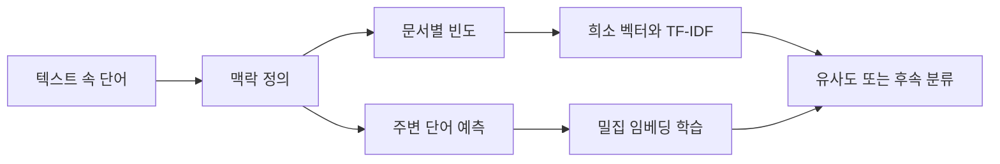

# 01. 단어 표현과 Word Embeddings

## 1. 단어 표현의 기초

### 1.1 자연어와 숫자 표현

자연어는 사람이 사용하는 한국어·영어 같은 언어다. 프로그래밍 언어 같은 인공어와 구분되며 다음 특성이 있다.

| 특성 | 의미 | 예 |
|---|---|---|
| 이산성 | 문자·단어라는 구별되는 기호로 구성 | 단어들을 나열해 문장을 만듦 |
| 자의성 | 기호와 의미의 연결은 관습 | `dog`라는 글자 자체에 개의 성질이 들어 있지 않음 |
| 생산성 | 유한한 단어로 새로운 문장을 계속 생성 | 처음 보는 문장도 이해·생성 가능 |
| 모호성·문맥 의존 | 같은 단어의 뜻이 주변 말에 따라 달라짐 | 배를 타다 / 배를 먹다 / 배가 아프다 |

신경망은 숫자 벡터를 계산하므로 단어를 벡터로 바꿔야 한다. 좋은 표현은 단어를 구별하면서 **비슷한 의미·쓰임을 가진 단어의 관계**도 담는다.

### 1.2 정수 ID와 one-hot

정수 ID는 어휘를 찾는 인덱스로는 유용하다. 그러나 `개=1, 고양이=2, 자동차=3`을 연속적인 수치 특징처럼 사용하면, 고양이가 개보다 크거나 개와 자동차의 평균이 고양이라는 가짜 구조가 생긴다. ID의 숫자 순서는 의미의 순서가 아니다.

One-hot은 어휘 수 $V$개의 좌표 중 자신의 좌표만 1인 벡터다. 각 단어를 별도로 식별하고 ID의 크기 문제를 피하지만, 다른 두 단어의 내적은 모두 0이다. 따라서 개–고양이와 개–자동차의 의미 차이를 구분하지 못한다.

**계산 예(설명용).** 어휘가 `[개, 고양이, 자동차]`이면 $e_1=(1,0,0)$, $e_2=(0,1,0)$, $e_3=(0,0,1)$이다. 서로 다른 벡터의 cosine은 모두 0이고, 유클리드 거리는 모두 $\sqrt2$다. 반면 같은 단어의 cosine은 1이다. “모든 단어쌍이 직교”라는 표현은 **서로 다른 단어**에 한정해야 한다.

### 1.3 분포 가설과 맥락

분포 가설(distributional hypothesis)은 **비슷한 맥락에 등장하는 단어가 비슷한 의미를 갖는다**는 가설이다. 단어의 의미를 텍스트 속의 쓰임에서 파악한다. Harris의 분포 관점, Wittgenstein의 “meaning is use”, Firth의 주변 단어 관점이 이 아이디어와 연결된다.

`wine`과 `gin`은 `everyone likes ___`, `a bottle of ___ is on the table`, `___ makes you drunk`, `a cocktail with ___ and seltzer`처럼 비슷한 문맥에 등장한다. 이처럼 **등장하는 문맥이 비슷한 단어는 의미도 비슷할 가능성이 높다.**

분산 표현(distributed representation)은 단어의 정보를 여러 벡터 성분에 나누어 담는 방식이다. 분포 기반 단어 표현에서는 주변 문맥의 정보를 이용해 벡터를 만든다.

| 맥락 정의 | 표현 또는 학습 방식 | 주로 포착하는 것 |
|---|---|---|
| 같은 문서에 등장 | Term-document matrix | 문서·주제에 따른 사용 분포 |
| 주변 window 안의 단어 | Word2Vec | 국소적인 동시 출현과 대체 가능한 쓰임 |
| 구문 의존관계 | Dependency embeddings | 구문적 관계에 따른 쓰임 |

맥락을 어떻게 정의하는지가 표현에 담기는 정보의 종류를 바꾼다. “분포 가설=Word2Vec”는 아니다. TF-IDF를 적용한 빈도 기반 표현도 문서 분포를 사용한다. 비슷한 맥락을 공유한다는 가설이 곧 모든 단어쌍의 정확한 동의어 판정을 보장하는 것도 아니다.

## 2. 희소 표현과 유사도

### 2.1 Term-document matrix

행은 단어(term), 열은 문서(document), 원소는 해당 단어가 해당 문서에 나타난 횟수다. 문서가 $N$개라면 한 단어를 나타내는 행 벡터는 $N$차원이다. 반대로 한 문서의 열을 읽으면 어휘별 빈도로 문서를 표현한다. 단어 표현과 문서 표현을 혼동하지 않아야 한다.

셰익스피어 희곡 8편에서 두 단어의 출현 빈도는 다음과 같다.

$$
A=\operatorname{knife}=[1,1,4,2,0,2,0,10]
$$
$$
B=\operatorname{sword}=[2,2,7,5,0,5,0,17]
$$

두 단어는 같은 문서들에서 함께 높은 빈도로 등장한다. `sword`가 전반적으로 더 자주 나타나더라도 **방향이 비슷한지**를 보면 유사한 문서 분포를 포착할 수 있다.

희소(sparse) 표현은 많은 성분이 0인 표현이다. One-hot은 $V$차원이며, term-document의 단어 행은 $N$차원이다. 각 좌표가 특정 단어 또는 문서에 대응하므로 의미를 해석하기 쉽지만, 차원이 크고 분포 정보가 성기다. 밀집(dense) 임베딩은 작은 차원 $H$의 실수 벡터를 학습해 많은 단어가 같은 좌표 공간을 공유한다.

> **구분:** 의미 유사도가 없는 것은 **one-hot 자체**다. Term-document 행에는 분포 정보가 있으므로 cosine으로 유사도를 비교할 수 있다. 희소 표현 전체에 의미 유사도가 없다고 일반화하지 않는다.

### 2.2 Cosine similarity와 계산

$$
\operatorname{sim}(A,B)=\cos\theta
=\frac{A^\top B}{\|A\|_2\|B\|_2}
=\frac{\sum_i A_iB_i}{\sqrt{\sum_i A_i^2}\sqrt{\sum_i B_i^2}}
$$

| 기호 | 역할 |
|---|---|
| $A,B$ | 같은 차원·같은 좌표 의미를 갖는 비교 대상 벡터 |
| $A^\top B$ | 대응 좌표의 곱을 모두 더한 내적 |
| $\|A\|_2$ | $A$의 유클리드 길이 |
| $\theta$ | 두 벡터 사이 각도 |

유클리드 거리는 두 점의 거리이며 벡터의 크기에 민감하다. Cosine은 길이를 정규화해 방향을 비교하므로 전체 빈도가 단순히 늘어난 경우에 덜 민감하다. 양의 상수 $q$에 대해 $\cos(A,qA)=1$이다. 범위는 $[-1,1]$이며 1은 같은 방향, 0은 직교, -1은 반대 방향이다. 비음수 빈도 벡터끼리는 음수 cosine이 나오지 않는다.

두 벡터의 내적과 제곱합은 다음과 같다.

$$
A^\top B=2+2+28+10+0+10+0+170=222
$$
$$
\|A\|_2^2=126,\qquad \|B\|_2^2=396
$$
$$
\cos(A,B)=\frac{222}{\sqrt{126}\sqrt{396}}\approx0.9938
$$

두 단어의 cosine similarity는 약 0.99다. 내적 222 자체만 비교하면 벡터의 전체 빈도도 영향을 주지만, cosine은 이를 정규화한다. 반면 knife–dog의 cosine similarity는 약 0.11이다.

**계산 예(설명용).** $u=(1,2)$, $v=(2,4)$이면 내적은 10, 길이는 $\sqrt5$와 $\sqrt{20}$이므로 cosine은 1이다. 두 벡터는 방향이 같지만 같은 점은 아니며, 거리는 $\sqrt5$다. 한 벡터가 영벡터이면 분모가 0이므로 cosine은 정의되지 않는다.

### 2.3 TF-IDF의 기호와 동작 원리

문서 안에서 자주 등장하는 단어의 중요도를 TF로, 전체 문서에서 흔하지 않은 정도를 IDF로 반영한다. 많이 나온다는 사실만으로 중요하다고 판단하면, 거의 모든 문서에 등장하는 흔한 단어가 결과를 지배할 수 있다.

$$
\operatorname{TFIDF}(t,d)=\operatorname{TF}(t,d)\operatorname{IDF}(t)
$$
$$
\operatorname{TF}(t,d)=n_{t,d}
\quad\text{또는}\quad
\frac{n_{t,d}}{\sum_k n_{k,d}},\qquad
\operatorname{IDF}(t)=\log\frac{N}{\operatorname{df}(t)}
$$

$t$는 단어, $d$는 문서, $n_{t,d}$는 그 문서에서의 출현 횟수다. $N$은 전체 문서 수, $\operatorname{df}(t)$는 단어를 **한 번 이상 포함하는 문서 수**다. 한 문서에서 100번 등장해도 df에는 1만 기여한다. TF는 문서 내부, IDF는 말뭉치 전체를 본다.

`like`가 8개 문서 모두에 등장하면 $\log(8/8)=0$이다. 덜 흔한 단어는 $\operatorname{df}(t)<N$이어서 양의 IDF를 가진다. 로그의 밑이 달라지면 수치는 달라지므로 계산 문제에서는 밑을 확인한다.

**계산 예(설명용): 작은 말뭉치**

자연로그를 사용한다.

| 문서 | 토큰 | `고양이` TF | `좋다` TF |
|---|---|---:|---:|
| $d_1$ | 고양이 고양이 좋다 | 2 | 1 |
| $d_2$ | 강아지 좋다 | 0 | 1 |
| $d_3$ | 영화 좋다 | 0 | 1 |

$N=3$, $\operatorname{df}(고양이)=1$, $\operatorname{df}(좋다)=3$이다. 원시 횟수 TF를 사용하면 $\operatorname{TFIDF}(고양이,d_1)=2\ln3\approx2.1972$, $\operatorname{TFIDF}(좋다,d_1)=1\ln1=0$이다. 상대빈도 TF를 쓰면 전자는 $(2/3)\ln3\approx0.7324$다. 같은 단어와 문서여도 TF 정의에 따라 값이 달라진다.

이 방식은 자주 나타나는 단어를 무조건 삭제하는 규칙이 아니다. 문서 간 구별력이 작은 단어의 가중치를 낮추는 통계적 방식이다. 문서들을 비교할 때는 각 문서가 **같은 어휘 순서**를 사용해야 한다.

### 2.4 TF-IDF smoothing과 주의점

분모에 1을 더한 변형 $\log\bigl(N/(1+\operatorname{df}(t))\bigr)$도 있다. Smoothing을 적용하지 않은 식과 구분할 점은 다음과 같다.

- 분모에 1을 더하면 **df=0**일 때 0으로 나누는 일을 막는다.
- 이 변형에서 df=N이면 $\log(N/(N+1))<0$이다. Smoothing을 적용하지 않은 식의 “모든 문서에 등장하면 IDF=0”과 수치를 섞지 않는다.
- TF 정의, 로그의 밑, smoothing 여부가 다르면 값도 달라진다. 서로 다른 정의의 수치를 섞어 계산하지 않는다.

## 3. 희소 표현에서 밀집 표현으로

TF-IDF는 관측된 빈도와 문서 분포를 직접 가중한다. Word2Vec은 주변 단어를 잘 예측하도록 파라미터를 학습하고 그 중간 표현을 임베딩으로 사용한다. 전자는 좌표가 어휘·문서에 대응하는 빈도 기반 표현이고, 후자는 좌표의 역할이 학습으로 결정되는 예측 기반 표현이다.

밀집 표현의 장점은 차원 축소만이 아니다. 비슷한 단어가 가까운 벡터를 가지면 후속 분류기가 통계적 강도(statistical strength)를 공유할 수 있다. 드물게 등장하는 `terrific`도 `great`, `wonderful`과 벡터가 가까우면 이들 단어의 학습 정보를 감성 분류에 활용할 수 있다. 다만 어떤 저차원 실수 벡터든 자동으로 좋은 의미를 담는 것은 아니다. 어떤 예측 과제로 어떻게 학습했는지가 중요하다.

**핵심 정리**

“단어를 벡터로 표현한다”는 것은 텍스트의 쓰임에서 얻은 정보를 수치 좌표에 담는 것이다. One-hot은 식별에는 충분하지만 의미 유사도를 제공하지 않는다. Term-document는 문서 분포를 담으며 cosine으로 방향을 비교한다. TF-IDF는 문서 내 빈도와 말뭉치 내 희귀성을 결합한다. Word2Vec은 예측 문제를 풀면서 밀집 표현을 학습한다.

## 4. Word2Vec

### 4.1 예측 기반 임베딩

TF-IDF가 관측된 통계에 가중치를 주었다면, 예측 기반 임베딩은 주어진 단어로 주변 단어를 잘 맞히는 문제를 풀면서 벡터를 얻는다.

일반 텍스트에서 중심 단어와 주변 단어의 쌍을 만들면, 사람이 라벨을 붙이지 않아도 텍스트 자체가 학습 신호를 제공한다. 이렇게 사전학습한 임베딩을 작은 라벨 데이터의 분류에 활용할 수 있다.

입력·정답 쌍이 만들어져 지도 예측의 계산 형식으로 학습하더라도, 원래 텍스트에 사람이 별도 라벨을 부착한 것은 아니다. 단어 예측 과제와 최종 감성 분류 과제는 서로 다르다. 사전학습의 목적은 후속 과제에서 재사용할 수 있는 표현을 얻는 것이다.

### 4.2 Skip-gram의 데이터와 계산 구조

Skip-gram은 **center word → context word**다. 문장 `a cocktail with gin and seltzer`에서 중심이 `gin`, window size가 3이면 `(gin,a)`, `(gin,cocktail)`, `(gin,with)`, `(gin,and)`, `(gin,seltzer)`를 만든다. 문장 경계 밖으로는 쌍을 만들 수 없어 이 위치의 문맥 단어는 5개다. window 안에서의 순서는 예측 목표에 따로 담지 않는다.

전체 문장을 순회하며 중심 위치를 바꾸어 이런 쌍을 생성한다. 한 중심 단어가 여러 정답 문맥 단어와 연결되므로, “중심 단어 하나당 정답 하나만 존재한다”는 뜻이 아니다. 각 학습 쌍에 대해서는 해당 문맥 단어가 정답이다.

![[assets/word2vec-architecture.svg]]

*Word2Vec 구조. 위쪽은 CBOW의 합/평균, 아래쪽은 Skip-gram의 중심 단어 입력을 대비한다.*

### 4.3 임베딩 행렬과 lookup

입력을 열벡터로 두면 행렬의 차원과 계산은 다음과 같다.

$$
x\in\mathbb R^V,\quad W\in\mathbb R^{V\times H},\quad
W'\in\mathbb R^{H\times V}
$$
$$
h=W^\top x\in\mathbb R^H,\qquad z=(W')^\top h\in\mathbb R^V
$$

$V$는 어휘 수, $H$는 임베딩 차원, $x$는 중심 단어의 one-hot이다. $W$의 각 행은 **입력으로 주어진 단어의 벡터**, $W'$의 각 열은 **예측될 문맥 단어의 벡터**다. $x$가 $c$번째 단어를 가리키면 $h$는 $W$의 $c$번째 행을 열벡터로 가져온 결과다. 실제로 거대한 one-hot을 만들어 행렬 전체를 곱할 필요 없이 행 인덱싱으로 구현할 수 있다.

두 행렬은 같은 어휘의 **입력 역할과 출력 역할**을 구분한다. 두 행렬을 무작위 초기화해 학습하고 보통 $W$를 최종 word embedding으로 사용한다.

### 4.4 출력 점수와 정답 확률

**출력 확률.** 문맥 단어 $o$의 출력 벡터를 $u_o$, 중심 벡터를 $v_c$라고 할 때 다음과 같다.

$$
z_o=u_o^\top v_c,\qquad
P(o\mid c)=\frac{\exp(u_o^\top v_c)}{\sum_{j=1}^{V}\exp(u_j^\top v_c)}
$$
$$
L(c,o)=-\log P(o\mid c)
$$

정답 문맥 단어에 큰 확률을 주면 손실이 작아진다. 후속 장의 [[03. Text Classification과 CNN#2.1 Softmax와 Cross-Entropy|Softmax와 CE]]와 같은 계산이다. 출력 차원은 $H$가 아니라 $V$이며, $h$의 작은 차원이 중간 표현의 역할을 한다.

**계산 예(설명용).** 어휘가 `[gin,cocktail,globe]`, 입력 벡터 $v_{gin}=(1,0)$, 출력 벡터가 $u_{gin}=(0,1)$, $u_{cocktail}=(\ln2,0)$, $u_{globe}=(0,-1)$이라고 하자. 점수는 $(0,\ln2,0)$, 지수는 $(1,2,1)$, 확률은 $(0.25,0.5,0.25)$다. 정답이 cocktail이면 손실은 $-\ln0.5\approx0.6931$이다.

### 4.5 CBOW와 Skip-gram

CBOW(Continuous Bag of Words)는 **context → center word**다. 여러 문맥 단어의 벡터를 합 또는 평균하여 하나의 projection으로 만든 뒤 중심 단어를 예측한다. Skip-gram은 중심 단어 한 개를 입력받아 여러 문맥 단어와 쌍을 만든다. 둘 다 window 안의 문맥을 bag으로 사용하여 그 안의 순서를 무시한다.

| 항목 | CBOW | Skip-gram |
|---|---|---|
| 조건 입력 | 주변 단어들 | 중심 단어 하나 |
| 예측 대상 | 중심 단어 | 주변 단어 |
| 중간 표현 | 문맥 벡터 합/평균 | 입력 벡터 하나 |
| 상대 학습 속도 | 빠름 | 쌍이 많아 상대적으로 느림 |
| 강점 | 자주 등장하는 단어에 안정적 | 희귀 단어, 큰 corpus |

**수식 전개.** 문맥 집합을 $C$라고 하면 CBOW의 평균 projection은 $h=|C|^{-1}\sum_{w\in C}v_w$다. 예를 들어 $(1,0)$과 $(0,1)$의 평균은 $(0.5,0.5)$다. 평균 자체는 어순을 알 수 없으므로 두 문맥 단어의 순서를 바꾸어도 같은 결과다.

비슷한 단어는 유사한 예측 과제를 공유한다. `the black ___ jumped on the table`에서 cat, dog, puppy는 같은 자리에 등장한다. 모델은 이 중심 단어들로 비슷한 문맥을 예측해야 한다. 반복되는 유사한 학습 신호가 입력 표현을 비슷하게 조정하는 방향으로 작용한다. 의미가 비슷한 dog/cat/puppy와 wrench/screwdriver가 각각 가까운 군집을 이루는 표현을 기대할 수 있다.

Skip-gram은 negative sampling과 함께 사용할 수 있다. 위 수식은 전체 어휘를 대상으로 하는 full-softmax 방식이다.

## 5. 사전학습과 평가

### 5.1 사전학습과 후속 과제 사용

작은 감성 라벨 데이터와 방대한 일반 텍스트는 서로 다른 학습 데이터다. 일반 텍스트의 단어 분포로 임베딩을 미리 학습(pre-train)하고, 이 표현을 CNN·RNN 같은 후속 모델의 입력으로 가져온다. 예를 들어 감성 리뷰 약 2K개만으로 표현을 학습하는 대신, 방대한 일반 텍스트에서 학습한 표현을 활용할 수 있다.

임베딩을 고정(freeze)하면 후속 과제 손실이 임베딩 파라미터를 바꾸지 않는다. Fine-tune하면 후속 과제에서 계산한 gradient를 임베딩까지 전달해 task에 맞게 갱신한다. Freeze는 분류기 전체를 학습하지 않는다는 뜻이 아니다. 임베딩을 고정하더라도 CNN 필터와 출력층은 학습할 수 있다.

공개 사전학습 표현에는 Word2Vec, GloVe, dependency embeddings가 있다. GloVe는 co-occurrence 통계를 활용하는 count·prediction 관점의 절충이다. Dependency embeddings는 맥락을 단순 인접 단어가 아니라 구문 의존관계로 정의한다. emoji2vec, node2vec는 임베딩 아이디어의 확장 사례다.

사전학습 lookup table의 각 행을 선택한다는 연산은 똑같더라도, 초기값과 갱신 여부가 달라지면 정보의 출처가 달라진다. `CNN-rand`와 `CNN-non-static`은 모두 임베딩을 갱신하지만 전자는 무작위 시작, 후자는 사전학습 시작이다. [[03. Text Classification과 CNN#6.1 임베딩 변형|CNN 변형]]에서 비교한다.

### 5.2 임베딩 평가

Relatedness 평가는 단어쌍에 대한 사람의 점수와 벡터 유사도 사이 상관을 본다. WordSim-353은 353개 단어쌍이며 midday–noon 9.29, professor–cucumber 0.31 같은 사람 판단이 있다. 임베딩의 cosine 값이 사람 점수와 얼마나 잘 대응하는지를 Pearson 또는 Spearman으로 비교한다. Pearson은 수치의 선형적 관계, Spearman은 순위 관계를 본다는 것이 이 차이를 이해하는 핵심이다.

Analogical reasoning은 단어 관계를 벡터 차로 표현해 빈칸을 찾는다.

$$
q=v(\mathrm{Berlin})-v(\mathrm{Germany})+v(\mathrm{France})
$$

이 $q$에 가장 가까운 후보가 Paris인지 본다. 예를 들어 $v(apple)-v(apples)\approx v(car)-v(cars)$, $v(king)-v(man)+v(woman)\approx v(queen)$와 같은 관계가 나타날 수 있다. 문법·지리·파생 관계의 일부는 선형 규칙성으로 표현되지만, 모든 관계에 정확한 벡터 등식이 성립한다는 뜻은 아니다.

**계산 예(설명용).** 가상의 벡터 $v(Germany)=(1,0)$, $v(Berlin)=(1,2)$, $v(France)=(3,0)$이면 $q=(3,2)$다. 후보 Paris가 $(3,2)$이면 cosine이 1이다.

단어쌍 평가의 상관이 높다고 모든 후속 분류에서 최고라고 단정할 수 없다. 평가 질문이 다르기 때문이다. 임베딩 관련성 평가, analogy 평가, 실제 문장 분류의 성능을 구분해 보고해야 한다.

## 6. Unseen words와 FastText

정적 단어 lookup은 학습 vocabulary에 없는 단어를 찾을 수 없다. 신조어·오타·형태 변화·전문용어가 모두 UNK 하나에 대응하면 서로 다른 단어가 같은 벡터를 받는다. Subword 모델은 단어 내부의 공유 구조를 이용한다. friend, friendly, friendship, unfriend, unfriendly는 구성 요소를 공유한다.

FastText는 단어 앞뒤에 `<`, `>`를 붙이고 character n-gram으로 분해한다. `<where>`의 3-gram은 `<wh`, `whe`, `her`, `ere`, `re>`다. 3–6-gram과 단어 자체의 embedding을 더해 단어 벡터를 구성한다.

$$
v_w=\sum_{g\in G_w}z_g
$$

$G_w$는 단어 $w$의 n-gram 집합이며 단어 자체도 포함한다. $z_g\in\mathbb R^H$는 구성 요소 $g$의 학습 벡터다. 모든 벡터의 차원이 같으므로 합한 단어 벡터도 $H$차원이다.

**계산 예(설명용).** 두 구성 요소의 벡터가 $(1,0)$, $(0,2)$이고 단어 자체가 $(1,1)$이면 합은 $(2,3)$이다. 미등장 단어의 자체 벡터를 사용할 수 없더라도, 학습된 구성 요소들이 있으면 그 합으로 표현을 만들 수 있다. 실제 where 예제에서는 모든 3–6-gram을 고려하므로 이 간단한 세 항 예제와 항 수를 혼동하지 않는다.

**한계의 구분.** Subword가 unseen 문제를 완화하는 것과 문맥의 다의성을 구분하는 것은 다르다. FastText는 여전히 단어 type에 대한 정적 표현이다. 같은 mouse가 동물인지 장치인지 문장별로 달라지는 문제를 자체적으로 해결한 것은 아니다.

## 7. 문장 벡터의 합성

토큰마다 $H$차원 임베딩을 얻으면 길이가 다른 벡터 시퀀스가 나온다. 분류기에 넣을 고정 길이 벡터 $d$가 필요할 때 다음과 같이 합성한다.

$$
d_{sum}=\sum_{i=1}^{n}x_i,\qquad
d_{avg}=\frac1n\sum_{i=1}^{n}x_i
$$
$$
(d_{max})_j=\max_i(x_i)_j,\qquad
d_{weighted}=\sum_{i=1}^{n}a_ix_i
$$

$n$은 토큰 수, $x_i$는 i번째 임베딩, $j$는 임베딩 성분이다. Max는 한 단어 벡터를 통째로 고르는 방식이 아니라 **성분별 최댓값**을 고른다. Sum은 문장 길이에 따라 크기가 커지기 쉽고, average는 길이 효과를 줄인다. 단순 sum/average/max는 순서를 잃는다.

**계산 예(설명용).** $x_1=(1,-1)$, $x_2=(3,2)$, $x_3=(-2,4)$이면 sum은 $(2,5)$, average는 $(2/3,5/3)$, max는 $(3,4)$다. 가중치 $(0.2,0.5,0.3)$이면 weighted sum은 $(1.1,2.0)$이다. Max의 $(3,4)$는 세 입력 중 어느 한 벡터와도 같지 않다.

가중치를 학습으로 정하는 입문적 Attention은 다음과 같다.

$$
r_i=v^\top x_i,\qquad a_i=\frac{e^{r_i}}{\sum_j e^{r_j}},\qquad d=\sum_i a_ix_i
$$

$v$는 학습되는 ‘중요한 단어’ 벡터, $r_i$는 중요도 점수, $a_i$는 합이 1인 가중치다. 예제의 점수 $[-3.4,2.4,-0.8,-1.2,1.7]$은 loved에 가장 큰 가중치를 부여한다. 표시된 0이나 0.64 등은 반올림이며 유한 점수의 softmax는 정확히 0이 되지 않는다.

문서 분류의 이 예에서는 학습 벡터 $v$가 점수를 만든다. 번역 Attention은 매 step 달라지는 decoder state가 점수를 만든다는 차이가 있다. 공통 구조는 **점수 → softmax → 가중합**이다. [[04. RNN 기반 기계번역과 Attention#7.2 Attention 계산과 기호|번역 Attention]]에서 이 구조를 다시 사용한다.

## 8. Type, token과 문맥화 표현

Type은 어휘 항목으로서의 단어이고 token은 문장에서 실제 등장한 한 사례다. `The mouse ran under the fridge`의 mouse와 `My wireless mouse needs batteries`의 mouse는 같은 type의 다른 token이다. Word2Vec, GloVe, FastText는 type마다 같은 벡터를 주므로 동물과 장치를 문장별로 구분하지 못한다.

문맥화(contextualized) 표현의 아이디어는 각 token의 표현을 주변 문맥에 민감하도록 변환하는 것이다. 동물 mouse는 rat/hamster 관련 표현, 장치 mouse는 keyboard/cursor 관련 표현을 갖는 것이 이상적이다. 출력 표현은 단어 임베딩을 쓰던 자리에 넣을 수 있으며 후속 과제에 맞게 학습될 수 있다.

## 9. 자기 점검과 답

1. Term-document에서 행과 열의 벡터 차원이 각각 무엇인가? **답:** 단어 행은 문서 수, 문서 열은 어휘 수다.
2. 같은 문서에서 한 단어가 10번 등장하면 df가 10 증가하는가? **답:** 해당 문서의 기여는 1이다.
3. One-hot의 크기를 줄이기만 하면 의미가 생기는가? **답:** 아니며, 의미 관계를 학습하거나 맥락 정보를 인코딩해야 한다.
4. Cosine 1은 두 벡터가 원소별로 같다는 뜻인가? **답:** 아니며 양의 배수도 1이다.
5. Skip-gram에서 정답 확률의 차원은? **$V$차원이며 임베딩 $H$차원과 다르다.**
6. Fine-tune와 contextualized는 같은가? **아니다. Fine-tune은 파라미터 갱신 여부, contextualized는 token별 문맥 반영 여부다.**
7. FastText의 강점과 남는 한계는? **구성 요소 공유로 미등장 단어를 표현하지만, type별 정적 표현의 다의성 한계는 남는다.**
8. Average pooling으로 `A likes B`와 `B likes A`의 관계 방향을 알 수 있는가? **같은 토큰 벡터 집합이면 평균은 같으므로 순서를 구분하지 못한다.**
