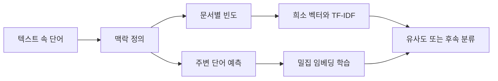

# 01. 단어 표현과 분포 가설

다음: [[02. Word Embeddings]]

## 1. 단어 표현의 기초

### 1.1 자연어와 숫자 표현

자연어는 사람이 사용하는 한국어·영어 같은 언어다. 프로그래밍 언어 같은 인공어와 구분되며 다음 특성이 있다.

| 특성 | 의미 | 예 |
|---|---|---|
| 이산성 | 문자·단어라는 구별되는 기호로 구성 | 단어들을 나열해 문장을 만듦 |
| 자의성 | 기호와 의미의 연결은 관습 | `dog`라는 글자 자체에 개의 성질이 들어 있지 않음 |
| 생산성 | 유한한 단어로 새로운 문장을 계속 생성 | 처음 보는 문장도 이해·생성 가능 |
| 모호성·문맥 의존 | 같은 단어의 뜻이 주변 말에 따라 달라짐 | 배를 타다 / 배를 먹다 / 배가 아프다 |

신경망은 숫자 벡터를 계산하므로 단어를 벡터로 바꿔야 한다. 좋은 표현은 단어를 구별하면서 **비슷한 의미·쓰임을 가진 단어의 관계**도 담는다.

### 1.2 정수 ID와 one-hot

정수 ID는 어휘를 찾는 인덱스로는 유용하다. 그러나 `개=1, 고양이=2, 자동차=3`을 연속적인 수치 특징처럼 사용하면, 고양이가 개보다 크거나 개와 자동차의 평균이 고양이라는 가짜 구조가 생긴다. ID의 숫자 순서는 의미의 순서가 아니다.

One-hot은 어휘 수 $V$개의 좌표 중 자신의 좌표만 1인 벡터다. 각 단어를 별도로 식별하고 ID의 크기 문제를 피하지만, 다른 두 단어의 내적은 모두 0이다. 따라서 개–고양이와 개–자동차의 의미 차이를 구분하지 못한다.

**계산 예(설명용).** 어휘가 `[개, 고양이, 자동차]`이면 $e_1=(1,0,0)$, $e_2=(0,1,0)$, $e_3=(0,0,1)$이다. 서로 다른 벡터의 cosine은 모두 0이고, 유클리드 거리는 모두 $\sqrt2$다. 반면 같은 단어의 cosine은 1이다. “모든 단어쌍이 직교”라는 표현은 **서로 다른 단어**에 한정해야 한다.

### 1.3 분포 가설과 맥락

분포 가설(distributional hypothesis)은 **비슷한 맥락에 등장하는 단어가 비슷한 의미를 갖는다**는 가설이다. 단어의 의미를 텍스트 속의 쓰임에서 파악한다. Harris의 분포 관점, Wittgenstein의 “meaning is use”, Firth의 주변 단어 관점이 이 아이디어와 연결된다.

예제의 빈칸은 `everyone likes ___`, `a bottle of ___ is on the table`, `___ makes you drunk`, `a cocktail with ___ and seltzer`다. `wine`, `gin`은 비슷한 환경에 들어갈 수 있다. 여러 문장에서 교체 가능한 쓰임을 모으면 단어의 관련성을 추정할 수 있다는 예다.

분산 표현(distributed representation)은 단어가 나타나는 맥락의 분포 정보를 벡터에 인코딩한다. 한 단어의 정보가 여러 성분에 걸쳐 표현된다고 이해하면 된다. 이 강의는 vector, representation, embedding을 문맥에 따라 넓게 혼용한다.

| 맥락 정의 | 표현 또는 학습 방식 | 주로 포착하는 것 |
|---|---|---|
| 같은 문서에 등장 | Term-document matrix | 문서·주제에 따른 사용 분포 |
| 주변 window 안의 단어 | Word2Vec | 국소적인 동시 출현과 대체 가능한 쓰임 |
| 구문 의존관계 | Dependency embeddings | 구문적 관계에 따른 쓰임 |

맥락을 어떻게 정의하는지가 표현에 담기는 정보의 종류를 바꾼다. “분포 가설=Word2Vec”는 아니다. TF-IDF를 적용한 빈도 기반 표현도 문서 분포를 사용한다. 비슷한 맥락을 공유한다는 가설이 곧 모든 단어쌍의 정확한 동의어 판정을 보장하는 것도 아니다.

## 2. 희소 표현과 유사도

### 2.1 Term-document matrix

행은 단어(term), 열은 문서(document), 원소는 해당 단어가 해당 문서에 나타난 횟수다. 문서가 $N$개라면 한 단어를 나타내는 행 벡터는 $N$차원이다. 반대로 한 문서의 열을 읽으면 어휘별 빈도로 문서를 표현한다. 단어 표현과 문서 표현을 혼동하지 않아야 한다.

강의의 셰익스피어 8개 희곡에서 다음 두 행을 비교한다.

$$
A=\operatorname{knife}=[1,1,4,2,0,2,0,10]
$$
$$
B=\operatorname{sword}=[2,2,7,5,0,5,0,17]
$$

두 단어는 같은 문서들에서 함께 높은 빈도로 등장한다. `sword`가 전반적으로 더 자주 나타나더라도 **방향이 비슷한지**를 보면 유사한 문서 분포를 포착할 수 있다.

희소(sparse) 표현은 많은 성분이 0인 표현이다. One-hot은 $V$차원이며, term-document의 단어 행은 $N$차원이다. 각 좌표가 특정 단어 또는 문서에 대응하므로 의미를 해석하기 쉽지만, 차원이 크고 분포 정보가 성기다. 밀집(dense) 임베딩은 작은 차원 $H$의 실수 벡터를 학습해 많은 단어가 같은 좌표 공간을 공유한다.

> **구분:** 의미 유사도가 없는 것은 **one-hot 자체**다. Term-document 행에는 분포 정보가 있으므로 cosine으로 유사도를 비교할 수 있다. 희소 표현 전체에 의미 유사도가 없다고 일반화하지 않는다.

### 2.2 Cosine similarity와 계산

$$
\operatorname{sim}(A,B)=\cos\theta
=\frac{A^\top B}{\|A\|_2\|B\|_2}
=\frac{\sum_i A_iB_i}{\sqrt{\sum_i A_i^2}\sqrt{\sum_i B_i^2}}
$$

| 기호 | 역할 |
|---|---|
| $A,B$ | 같은 차원·같은 좌표 의미를 갖는 비교 대상 벡터 |
| $A^\top B$ | 대응 좌표의 곱을 모두 더한 내적 |
| $\|A\|_2$ | $A$의 유클리드 길이 |
| $\theta$ | 두 벡터 사이 각도 |

유클리드 거리는 두 점의 거리이며 벡터의 크기에 민감하다. Cosine은 길이를 정규화해 방향을 비교하므로 전체 빈도가 단순히 늘어난 경우에 덜 민감하다. 양의 상수 $q$에 대해 $\cos(A,qA)=1$이다. 범위는 $[-1,1]$이며 1은 같은 방향, 0은 직교, -1은 반대 방향이다. 비음수 빈도 벡터끼리는 음수 cosine이 나오지 않는다.

강의 벡터의 내적과 제곱합을 순서대로 계산한다.

$$
A^\top B=2+2+28+10+0+10+0+170=222
$$
$$
\|A\|_2^2=126,\qquad \|B\|_2^2=396
$$
$$
\cos(A,B)=\frac{222}{\sqrt{126}\sqrt{396}}\approx0.9938
$$

따라서 강의의 약 0.99와 일치한다. 내적 222 자체만 비교하면 벡터의 전체 빈도도 영향을 주지만, cosine은 이를 정규화한다. 강의에서는 knife–dog가 약 0.11이라고 제시한다.

**계산 예(설명용).** $u=(1,2)$, $v=(2,4)$이면 내적은 10, 길이는 $\sqrt5$와 $\sqrt{20}$이므로 cosine은 1이다. 두 점은 같은 점이 아니고 거리는 $\sqrt5$다. 이 예로 거리와 방향의 차이를 설명할 수 있다. 한 벡터가 영벡터이면 분모가 0이므로 이 수식은 정의되지 않는다. 빈도가 없는 대상에 cosine을 그대로 적용하지 않는다.

### 2.3 TF-IDF의 기호와 동작 원리

문서 안에서 자주 등장하는 단어의 중요도를 TF로, 전체 문서에서 흔하지 않은 정도를 IDF로 반영한다. 많이 나온다는 사실만으로 중요하다고 판단하면, 거의 모든 문서에 등장하는 흔한 단어가 결과를 지배할 수 있다.

$$
\operatorname{TFIDF}(t,d)=\operatorname{TF}(t,d)\operatorname{IDF}(t)
$$
$$
\operatorname{TF}(t,d)=n_{t,d}
\quad\text{또는}\quad
\frac{n_{t,d}}{\sum_k n_{k,d}},\qquad
\operatorname{IDF}(t)=\log\frac{N}{\operatorname{df}(t)}
$$

$t$는 단어, $d$는 문서, $n_{t,d}$는 그 문서에서의 출현 횟수다. $N$은 전체 문서 수, $\operatorname{df}(t)$는 단어를 **한 번 이상 포함하는 문서 수**다. 한 문서에서 100번 등장해도 df에는 1만 기여한다. TF는 문서 내부, IDF는 말뭉치 전체를 본다.

강의에서는 `like`가 8개 문서 모두에 등장하므로 $\log(8/8)=0$이라고 설명한다. 덜 흔한 단어는 $\operatorname{df}(t)<N$이어서 양의 IDF를 가진다. 로그의 밑이 달라지면 수치는 달라지므로 계산 문제에서는 밑을 확인한다.

**계산 예(설명용): 작은 말뭉치**

다음은 강의 수식을 설명하기 위해 새로 만든 예제이며 자연로그를 사용한다.

| 문서 | 토큰 | `고양이` TF | `좋다` TF |
|---|---|---:|---:|
| $d_1$ | 고양이 고양이 좋다 | 2 | 1 |
| $d_2$ | 강아지 좋다 | 0 | 1 |
| $d_3$ | 영화 좋다 | 0 | 1 |

$N=3$, $\operatorname{df}(고양이)=1$, $\operatorname{df}(좋다)=3$이다. 원시 횟수 TF를 사용하면 $\operatorname{TFIDF}(고양이,d_1)=2\ln3\approx2.1972$, $\operatorname{TFIDF}(좋다,d_1)=1\ln1=0$이다. 상대빈도 TF를 쓰면 전자는 $(2/3)\ln3\approx0.7324$다. 같은 단어와 문서여도 TF 정의에 따라 값이 달라진다.

이 방식은 자주 나타나는 단어를 무조건 삭제하는 규칙이 아니다. 문서 간 구별력이 작은 단어의 가중치를 낮추는 통계적 방식이다. 문서들을 비교할 때는 각 문서가 **같은 어휘 순서**를 사용해야 한다.

### 2.4 TF-IDF 평활과 주의점

분모에 1을 더한 변형 $\log\bigl(N/(1+\operatorname{df}(t))\bigr)$도 있다. 비평활 식과 구분할 점은 다음과 같다.

- 분모에 1을 더하면 **df=0**일 때 0으로 나누는 일을 막는다. 원문의 “df=N일 때 분모가 0”이라는 설명은 수식과 맞지 않는다.
- 이 변형에서 df=N이면 $\log(N/(N+1))<0$이다. 비평활 식의 “모든 문서에 등장하면 IDF=0”과 수치를 섞지 않는다.
- 강의 표의 약 0.12, 0.20은 분모+1 및 상용로그 표기와 맞는 항목들이 있지만, `like=0`은 비평활 설명이다. **표의 반올림 값과 다른 정의를 혼합해 재계산하지 않는다.** 이 개념서의 예제는 비평활 식과 자연로그를 명시한다.

## 3. 희소 표현에서 밀집 표현으로

TF-IDF는 관측된 빈도와 문서 분포를 직접 가중한다. Word2Vec은 주변 단어를 잘 예측하도록 파라미터를 학습하고 그 중간 표현을 임베딩으로 사용한다. 전자는 좌표가 어휘·문서에 대응하는 빈도 기반 표현이고, 후자는 좌표의 역할이 학습으로 결정되는 예측 기반 표현이다.

밀집 표현의 장점은 차원 축소만이 아니다. 비슷한 단어가 가까운 벡터를 가지면 후속 분류기가 통계적 강도(statistical strength)를 공유할 수 있다. 강의에서는 드물게 본 `terrific`도 `great`, `wonderful`과 가까우면 감성 분류에서 도움이 된다고 설명한다. 다만 어떤 저차원 실수 벡터든 자동으로 좋은 의미를 담는 것은 아니다. 어떤 예측 과제로 어떻게 학습했는지가 중요하다.

**핵심 정리**

“단어를 벡터로 표현한다”는 것은 텍스트의 쓰임에서 얻은 정보를 수치 좌표에 담는 것이다. One-hot은 식별에는 충분하지만 의미 유사도를 제공하지 않는다. Term-document는 문서 분포를 담으며 cosine으로 방향을 비교한다. TF-IDF는 문서 내 빈도와 말뭉치 내 희귀성을 결합한다. Word2Vec은 예측 문제를 풀면서 밀집 표현을 학습한다.

**자기 점검**

1. Term-document에서 행과 열의 벡터 차원이 각각 무엇인가? **답:** 단어 행은 문서 수, 문서 열은 어휘 수다.
2. 같은 문서에서 한 단어가 10번 등장하면 df가 10 증가하는가? **답:** 해당 문서의 기여는 1이다.
3. One-hot의 크기를 줄이기만 하면 의미가 생기는가? **답:** 아니며, 의미 관계를 학습하거나 맥락 정보를 인코딩해야 한다.
4. Cosine 1은 두 벡터가 원소별로 같다는 뜻인가? **답:** 아니며 양의 배수도 1이다.

연결: [[02. Word Embeddings#1.2 Skip-gram의 데이터와 계산 구조|예측 기반 표현]]
