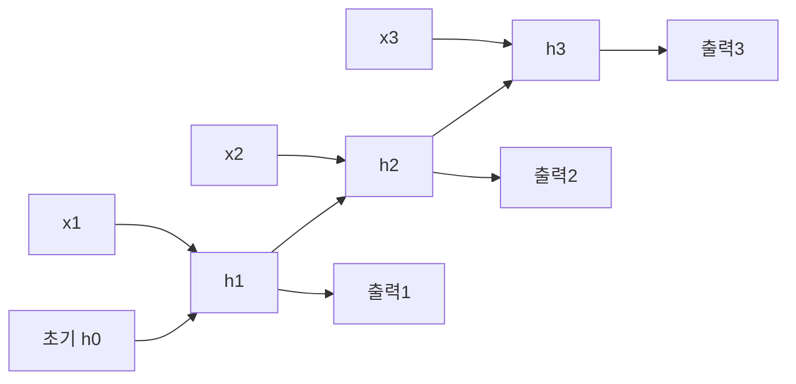
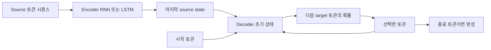

# 04. RNN 기반 기계번역과 Attention

## 1. RNN

### 1.1 Sequential data

기계번역은 입력 단어 시퀀스를 출력 단어 시퀀스로 바꾸는 many-to-many 과제다.

RNN(Recurrent Neural Network)은 연속적인 입력을 처리하도록 설계된다. 가변 길이를 다루며 hidden state를 기억처럼 두고 각 timestep에 갱신한다. 이전 state가 다음 계산에 쓰이므로 같은 토큰이라도 앞의 입력에 따라 현재 state가 달라질 수 있다. 임베딩 평균이 순서를 버리는 것과 다르다.

시퀀스 모델은 입력·출력 구조에 따라 one-to-one, one-to-many, many-to-one, many-to-many로 구분한다. 문장 분류는 여러 입력에서 최종 한 출력을 만들 수 있고, 번역은 source와 target의 길이가 다른 시퀀스를 연결한다. Many-to-many라고 입력 위치와 출력 위치가 반드시 하나씩 정렬되는 것은 아니다.

### 1.2 RNN의 구조와 기호

$$
h_t=\tanh(W_{xh}x_t+W_{hh}h_{t-1}+b)
$$

| 기호 | 크기와 역할 |
|---|---|
| $x_t\in\mathbb R^d$ | 현재 토큰 입력, 보통 임베딩 |
| $h_{t-1},h_t\in\mathbb R^H$ | 이전/현재 hidden state |
| $W_{xh}\in\mathbb R^{H\times d}$ | 현재 입력을 state 공간으로 변환 |
| $W_{hh}\in\mathbb R^{H\times H}$ | 이전 state를 새 state 계산에 연결 |
| $b\in\mathbb R^H$ | State 편향 |

두 선형 변환을 더하고 tanh를 적용해 각 state 성분을 $[-1,1]$로 제한한다. $W_{xh},W_{hh}$와 출력용 $W_{hy}$는 모든 시간에서 공유한다. 그림에 cell이 여러 개 그려져 있어도 시간마다 별도 가중치를 만드는 것이 아니다.

**출력 계산.** 언어모델의 출력층을 풀어 쓰면 $z_t=W_{hy}h_t+b_y$, $p_t=softmax(z_t)$다. State H차원, 출력 어휘 V차원을 구분한다. `[h,e,l,o]` 어휘에서 다음 글자를 sampling하면 그 결과를 다음 시점의 입력으로 사용한다. Sampling은 확률에 따라 고르는 것이고 greedy argmax와 같지 않다.

모든 h 노드는 같은 recurrent 변환을 사용한다. $h_t$는 입력의 원문을 그대로 저장하는 배열이 아니라 학습된 압축 표현이다. 이전 토큰을 정확하게 복원할 수 있다고 보장하지 않는다.

**계산 예(설명용): scalar RNN 두 step**

$W_{xh}=1$, $W_{hh}=0.5$, $b=0$, $h_0=0$, $x_1=1$, $x_2=0$이라고 하자.

$$
h_1=\tanh(1)\approx0.76159
$$
$$
h_2=\tanh(0+0.5\cdot0.76159)\approx0.36340
$$

두 번째 입력이 0이어도 이전 state가 있으므로 출력이 0은 아니다. $x_3=0$이면 $h_3=\tanh(0.5h_2)\approx0.17973$로 줄어든다. 이 예는 해당 계수에서 앞의 신호가 약해지는 과정을 보여주지만 모든 RNN state가 언제나 단조 감소한다는 일반 법칙은 아니다.

### 1.3 Stacked RNN과 bidirectional RNN

Multi-layer/stacked RNN은 아래 층의 hidden state를 위 층의 입력으로 사용한다. 시간 방향 반복의 깊이에 layer 방향 깊이가 추가된다. 하위 층은 비교적 저수준 feature, 상위 층은 고수준 feature를 학습할 수 있다. 2–3층처럼 여러 층을 쌓을 수 있지만 과도한 깊이는 학습을 어렵게 만들 수 있다. 4층 초과에서 성능이 떨어지는 경향도 데이터·모델·학습 설정에 따라 달라지므로 고정된 한계값은 아니다.

Bidirectional RNN은 앞→뒤와 뒤→앞을 각각 encoding하고 같은 위치의 두 state를 concat한다.

$$
h_t^{bi}=[\overrightarrow h_t;\overleftarrow h_t]
$$

**보충 차원:** 각 방향 H차원이면 concat은 2H차원이다. 앞 방향은 왼쪽 문맥, 뒤 방향은 오른쪽 문맥을 포함할 수 있다. 전체 source가 주어진 번역 encoder에 적합한 관점이다. 미래 target이 아직 없는 생성 decoder에서 양방향 정보를 그대로 쓰는 것은 같은 조건이 아니다.

양방향 문맥이 성능에 도움이 될 수 있지만, 모든 과제에서 일정한 개선 폭이 보장되지는 않는다.

### 1.4 장기 의존성의 한계

`I grew up in France … I speak fluent ___`에서 뒤의 French를 예측하려면 멀리 앞에 나온 France의 정보를 유지해야 한다. Recurrent step이 많아지면 중요한 정보가 state 갱신 속에서 희석될 수 있다. Tanh가 state 값을 제한한다고 해서 gradient까지 소실·폭발이 완전히 방지되는 것은 아니다.

**수식 전개.** $a_t=W_{xh}x_t+W_{hh}h_{t-1}+b$이면, 시간축의 국소 미분은:

$$
\frac{\partial h_t}{\partial h_{t-1}}
=\operatorname{diag}(1-h_t^2)W_{hh}
$$

먼 이전 state까지의 미분에는 이런 항들이 반복 곱으로 나타난다. 작은 크기의 항이 여러 번 곱해지면 gradient가 약해지고 큰 항이 반복되면 커질 수 있다. Scalar에서 국소 계수가 매번 0.5라면 10단계 뒤의 경로 계수는 $0.5^{10}\approx0.0009766$다.

표현 정보가 약해지는 현상과 학습 gradient가 약해지는 현상은 연결되지만 같은 값은 아니다. Hidden state의 현재 수치와 $\partial L/\partial h_t$를 구분한다. LSTM은 중요한 정보를 유지하는 별도 cell 경로를 도입해 이 문제를 완화한다.

## 2. LSTM

### 2.1 Cell, hidden state와 gate

LSTM(Long Short-Term Memory)은 cell state $c_t$에 정보를 저장하고 gate가 무엇을 유지·추가·출력할지 정한다. Hidden state $h_t$는 외부로 내보내는 현재 표현이다. 같은 H차원이어도 두 state의 역할이 다르다. 이전 $h_{t-1}$과 현재 $x_t$를 concat한 $q_t=[h_{t-1};x_t]$로 gate와 후보를 계산한다.

$$
f_t=\sigma(W_fq_t+b_f)
$$
$$
i_t=\sigma(W_iq_t+b_i),\qquad
\tilde c_t=\tanh(W_cq_t+b_c)
$$
$$
c_t=f_t\odot c_{t-1}+i_t\odot\tilde c_t
$$
$$
o_t=\sigma(W_oq_t+b_o),\qquad
h_t=o_t\odot\tanh(c_t)
$$

$f_t,i_t,o_t$는 H차원 gate, $\tilde c_t$는 H차원 후보 cell 값, $\odot$는 **원소별 곱**이다. $W_f,W_i,W_c,W_o$는 각각 H×(H+d), bias는 H차원이다. 서로 다른 gate가 독립된 파라미터를 갖지만 각 파라미터는 시간마다 공유한다.

| 구성 | 질문 | 범위와 작동 |
|---|---|---|
| Forget gate $f_t$ | 과거 cell에서 얼마나 남길까 | Sigmoid: 0에 가까우면 버림, 1에 가까우면 유지 |
| Input gate $i_t$ | 새 후보를 얼마나 쓸까 | Sigmoid: 후보의 성분별 반영량 |
| Candidate $\tilde c_t$ | 어떤 새 정보를 쓸까 | Tanh: 양수·음수 후보값 |
| Cell update $c_t$ | 유지된 과거와 새 정보 결합 | 덧셈 경로 |
| Output gate $o_t$ | 현재 기억을 얼마나 외부로 보일까 | Tanh(cell)을 성분별 필터링 |

Gate는 보통 완전한 0/1 스위치가 아니라 연속적인 비율이다. Sigmoid gate가 양수라고 저장 내용도 양수인 것은 아니다. 후보 $\tilde c_t$가 음수일 수 있어 cell에 음의 정보를 더할 수 있다. Cell은 합으로 갱신되므로 hidden처럼 반드시 $[-1,1]$에 제한되지는 않는다.

![[assets/lstm-architecture.svg]]

*LSTM 내부 구조. 위쪽 직선 경로는 cell, 아래쪽은 gate의 공통 입력 q. ×는 원소별 곱, +는 cell 정보 결합이다. 후보와 input gate의 역할을 분리하여 읽는다.*

### 2.2 LSTM gate와 state의 계산 예제

**Gate 계산**

단일 성분에서 forget logit이 $\ln4$, input logit이 $\ln(3/2)$, output logit이 $\ln(7/3)$이면:

$$
f=\frac4{1+4}=0.8,\qquad i=\frac{1.5}{1+1.5}=0.6,\qquad
o=\frac{7/3}{1+7/3}=0.7
$$

이 값은 affine로 계산된 gate 점수에 sigmoid를 적용한 결과다. Gate logit과 gate 출력 자체를 혼동하지 않는다. 후보 affine 점수가 $\operatorname{arctanh}(0.4)$면 후보는 tanh를 거쳐 0.4가 된다. 실제로는 모든 gate가 $q_t$에서 계산되지만 예제에서는 gate 값을 지정해 state 갱신을 계산한다.

**Cell과 hidden state 갱신**

$$
c_{t-1}=(0.5,-1.0),\quad f_t=(0.8,0.2),\quad
i_t=(0.6,0.9),\quad\tilde c_t=(0.4,-0.5),\quad o_t=(0.7,0.3)
$$

과거 유지분은 $(0.4,-0.2)$, 새 정보는 $(0.24,-0.45)$이다. 따라서:

$$
c_t=(0.64,-0.65)
$$
$$
h_t=(0.7\tanh0.64,\ 0.3\tanh(-0.65))
\approx(0.39543,-0.17150)
$$

첫 성분은 과거를 많이 남기고 새 양의 정보를 추가했다. 둘째 성분은 과거를 대부분 잊고 새 음의 정보를 주로 넣었다. Output gate가 0.3이라고 cell 값 -0.65가 지워지는 것이 아니다. 외부로 보이는 hidden의 해당 성분을 줄인 것이다.

**극단적인 gate의 해석**

$f=1$, $i=0$인 이상화된 경우 $c_t=c_{t-1}$로 기억을 유지한다. $f=0$, $i=1$이면 $c_t=\tilde c_t$로 새 후보만 남긴다. $o=0$이면 $h_t=0$이어도 cell 기억은 남을 수 있다. 실제 유한 logit의 sigmoid는 정확한 0·1에 도달하지 않으므로 이 값들은 극한적인 역할 설명이다.

Gate 값을 고정하고 cell의 직접 경로만 보면 $\partial c_t/\partial c_{t-1}=f_t$다. Forget gate가 1에 가까우면 gradient가 더 안정적으로 흐를 수 있다. Gate가 작으면 직접 경로도 약해지고, gate의 state 의존성까지 포함한 전체 미분은 더 복잡하다. LSTM은 gradient 소실과 장기 의존성 문제를 완화하지만 완전한 해결을 보장하지 않는다.

## 3. RNN과 LSTM의 비교

| 비교 | Basic RNN | LSTM |
|---|---|---|
| 기억 | Hidden state 하나 | Cell과 hidden 분리 |
| 갱신 | Affine 후 tanh | 유지·추가를 gate로 결정하고 합침 |
| 출력 조절 | State가 곧 현재 표현 | Output gate로 노출량 조절 |
| 시간 공유 | Recurrent 가중치 공유 | Gate별 가중치 모두 시간 공유 |
| 장점 | 단순한 순차 모델 | 긴 정보 보존을 더 잘 학습할 경로 |
| 한계/비용 | 긴 의존성 학습이 어려움 | Gate로 계산·파라미터 증가, 완전 해결 보장 없음 |

**보충 파라미터 계산.** Input d, hidden H일 때 basic RNN의 state 갱신 파라미터는 $H(d+H+1)$이다. LSTM은 네 affine 변환이 있으므로 $4H(d+H+1)$이다. 출력층은 별도로 더한다. 이 숫자로 “LSTM이 RNN보다 구조가 복잡하다”를 설명할 수 있다.

RNN/LSTM은 문장 encoder로 state를 만들고 decoder로 target을 순차 생성할 수 있다. 다만 LSTM의 시간축 기억 개선과 Seq2Seq의 source 전체를 한 벡터에 압축하는 병목은 다른 문제다. 다음 장은 encoder-decoder, 그 다음 장은 Attention으로 연결한다.

## 4. Seq2Seq

### 4.1 Encoder–Decoder

NMT(Neural Machine Translation)는 하나의 end-to-end 신경망으로 source 문장을 target 문장으로 번역하는 sequence-to-sequence 모델이다.

Encoder RNN은 source 토큰을 읽으며 state를 갱신한다. 마지막 hidden state를 decoder의 초기 상태로 전달한다. Decoder RNN은 source encoding에 조건화된 언어모델로 target 토큰을 하나씩 생성한다. Source와 target은 길이와 어순이 달라도 된다.

Source 전체를 먼저 encoding하고 target 생성을 시작한다. Decoder의 한 step은 이전 target 정보와 현재 decoder state를 사용해 다음 어휘 분포를 만든다. 그림의 target 출력과 다음 step 입력이 한 칸 이동하는 이유는 **이전 토큰으로 다음 토큰을 예측**하기 때문이다. 시작 토큰은 첫 target 예측을 시작하고 종료 토큰은 문장 생성을 끝내는 역할이다.

**보충 표기.** Source를 $x=(x_1,\ldots,x_N)$, target을 $y=(y_1,\ldots,y_T)$라고 쓰면 encoder $h_N$이 decoder $s_0$의 초기 정보가 된다. RNN decoder에서는 $s_t=f(s_{t-1},emb(y_{t-1}))$ 형태로 이해할 수 있다. LSTM일 때는 hidden과 cell이 함께 상태를 이룬다는 점을 별도로 고려한다.

### 4.2 Seq2Seq 확률과 손실

$$
P(y\mid x)=\prod_{t=1}^{T}P(y_t\mid y_1,\ldots,y_{t-1},x)
$$
$$
J_t=-\log P(y_t\mid y_1,\ldots,y_{t-1},x),\qquad
J=\frac1T\sum_{t=1}^{T}J_t
$$

$N$은 source 길이, $T$는 평가할 target 예측 step 수, $y_t$는 그 step의 정답 토큰이다. 각 step의 어휘 Softmax에서 **정답 단어 확률**을 가져와 negative log를 계산한다. 평균 손실은 문장 길이로 나눈다. 확률 곱은 로그를 취하면 합으로 바뀌므로 작은 확률을 직접 계속 곱하지 않아도 된다.

**계산 예(설명용): 세 target step**

정답 토큰들의 확률이 `[0.8,0.5,0.25]`라면:

| Step | 정답 확률 | $J_t=-\ln p_t$ |
|---|---:|---:|
| 1 | 0.8 | 0.22314 |
| 2 | 0.5 | 0.69315 |
| 3 | 0.25 | 1.38629 |

조건부 sequence 확률은 $0.8\cdot0.5\cdot0.25=0.1$이다. 합 NLL은 $-\ln0.1\approx2.30259$, 평균은 $2.30259/3\approx0.76753$이다. 세 번째 정답 확률이 가장 작아서 loss 기여가 가장 크다.

**보충 주의.** EOS까지 정답으로 학습하는 설정이면 EOS 예측도 T에 포함한다. Padding 위치를 실제 정답 토큰으로 세지 않도록 해야 한다. 위 예제는 T=3이다. 합 손실과 평균 손실을 구분한다.

### 4.3 학습과 생성의 입력 차이

Seq2Seq 손실은 정답 prefix $y_1,\ldots,y_{t-1}$에 조건화한 예측 확률로 계산한다. 학습 때 이전 정답 토큰을 다음 입력으로 사용하는 방식을 teacher forcing이라고 한다. 생성 때는 아직 정답을 모르므로 이미 생성한 토큰을 다음 입력으로 사용한다.

틀린 이전 토큰을 생성하면 이후 조건이 달라져 뒤의 확률도 달라질 수 있다. “각 step에서 가장 좋은 확률을 고르면 전체 문장이 가장 좋다”는 결론이 성립하지 않는 이유와 연결된다. 학습에서는 decoder의 오차가 encoder까지 역전파되어 전체 시스템이 함께 최적화된다. Encoder를 별도 고정 feature extractor로만 학습하는 구조와 다르다.

## 5. Decoding

### 5.1 Greedy decoding

Greedy는 매 step 가장 높은 확률의 토큰을 하나 선택한다.

$$
\hat y_t=\arg\max_wP(w\mid\hat y_{<t},x)
$$

각 시점에는 선택이 최선이어도 다른 초기 선택으로 시작한 문장 전체의 확률이 더 높을 수 있다. 이미 버린 대안을 뒤에서 다시 복구하지 못한다. `he → he hit → he hit a`처럼 한 경로만 선택하면, 이후 더 좋은 대안을 발견해도 앞의 선택으로 되돌아갈 수 없다.

**계산 예(설명용).** 첫 단어 후보 A=0.6, B=0.4이고 A 다음 가장 좋은 후보 C=0.5, B 다음 D=0.9라고 하자. 두 토큰 길이에서 greedy는 A를 골라 AC 확률 $0.6\cdot0.5=0.30$으로 끝난다. BD는 $0.4\cdot0.9=0.36$이어서 더 높다. 첫 step 최고 확률과 완성 sequence 최고 확률은 다르다.

Greedy는 한 경로만 유지하므로 간단하고 빠르다. Sampling은 확률적으로 후보를 고르고 beam은 여러 경로를 유지하므로 이 세 방식의 차이를 구분한다. Decoder 구조를 바꾸는 것이 아니라 **출력 분포에서 무엇을 선택할지**를 바꾸는 전략이다.

### 5.2 Beam search의 점수와 가지치기

Beam은 상위 k개의 부분 번역(hypothesis)을 유지한다. k는 beam size다. 예를 들어 5–10개 후보를 유지할 수 있지만, 적절한 크기는 모델·과제·계산 예산에 따라 달라진다.

$$
score(y_{1:t})=\log P(y_{1:t}\mid x)
=\sum_{i=1}^{t}\log P(y_i\mid y_{<i},x)
$$

확률이 0과 1 사이면 로그는 음수이고 **덜 음수일수록 점수가 높다**. 확률 1의 로그는 0이므로 엄밀히는 비양수다. 각 step에서 남아 있는 k개 prefix를 확장하고 그 모든 자식 후보를 모아 누적 score의 상위 k개를 선택한다. 각 parent에서 하나씩 뽑는 규칙이 아니다. 하나의 parent에서 나온 자식들이 beam을 모두 차지할 수 있다.

**계산 예(설명용): beam size 2**

어휘를 A,B,C,D로 두고 모든 경로를 두 토큰 후 종료하는 작은 예를 사용한다. 첫 step 분포는 A=0.6, B=0.4, 나머지 0이다. A 뒤 분포는 C=0.5, D=0.3, A=0.1, B=0.1이다. B 뒤 분포는 D=0.9, C=0.05, A=0.025, B=0.025다.

| Step 1 유지 | 확률 | 누적 log score |
|---|---:|---:|
| A | 0.6 | -0.51083 |
| B | 0.4 | -0.91629 |

Step 2에서 각 prefix를 확장한다.

| 확장 | Sequence 확률 | 누적 log score | 결과 |
|---|---:|---:|---|
| BD | 0.36 | -1.02165 | 1위 유지 |
| AC | 0.30 | -1.20397 | 2위 유지 |
| AD | 0.18 | -1.71480 | 가지치기 |
| AA, AB | 각 0.06 | 각 -2.81341 | 가지치기 |
| BC | 0.02 | -3.91202 | 가지치기 |
| BA, BB | 각 0.01 | 각 -4.60517 | 가지치기 |

Greedy는 AC를 선택하지만 beam=2는 BD도 유지하여 더 높은 완성 점수의 경로를 찾는다. 이 예는 EOS 확률을 모두 1로 이상화했으므로 이후 종료 log는 0이며 순위가 바뀌지 않는다. 실제 종료 문제는 다음 절처럼 따로 처리한다.

![[assets/beam-search.svg]]

*새로 만든 위 계산 예의 탐색 트리. 파란 가지는 step 2 상위 2개, 회색은 가지치기. 노드 숫자는 조건부 확률이 아니라 누적 log score다.*

**Beam search의 순서**

1. 시작 상태를 하나의 빈 prefix로 둔다.
2. 살아 있는 각 prefix에서 다음 토큰 확률을 계산한다.
3. 이전 누적 score에 해당 토큰의 log 확률을 더한다.
4. 확장 후보 전체에서 상위 k개를 유지한다.
5. 종료한 후보를 관리하고, 최종 최고점 경로를 backtrack해 복원한다.

### 5.3 종료, 한계와 탐색 목적

종료 토큰을 생성한 hypothesis는 완성된 문장이다. 이후 다른 토큰으로 계속 확장하지 않는다. 구현에서는 미완성 beam과 완성 후보를 구분하고 최대 길이 등의 조건을 정한다.

원래 log 확률 합은 토큰을 추가할 때 비양수 항을 더하므로 길어질수록 낮아지기 쉽다. 서로 다른 길이 후보를 비교할 때 이런 성질을 인지해야 한다. 위 score는 길이 보정이 없는 순수 누적 log 확률이다.

Beam은 exhaustive search보다 훨씬 적은 후보를 유지하지만 최적해를 보장하지 않는다. 초기에 낮은 prefix가 나중에 매우 좋은 후속 토큰으로 이어져도 이미 가지치기되었으면 되살아나지 않는다. k=1은 기본 동일 길이 확장 관점에서 greedy와 같고, k를 키우면 더 많은 대안을 보지만 계산·메모리 비용이 늘어난다.

**보충 비용 해석.** 어휘 V개를 k개 prefix마다 검사하면 step당 약 kV개의 확장 점수를 비교한다. 모든 길이 T 시퀀스를 완전 탐색하면 후보 수는 V의 T제곱 수준으로 증가한다. Beam은 후보 수를 제한해 현실적인 탐색을 한다.

높은 model score가 사람이 보기에 완벽한 번역이라는 보장은 아니다. Beam은 주어진 모델의 확률 목표를 탐색하고, BLEU는 reference와 n-gram 일치를 평가한다. Training loss, decoding score, 번역 품질 평가를 서로 같은 값으로 취급하지 않는다.

## 6. 정보 병목과 Attention

Basic 모델은 마지막 source state 하나만 사용한다. Source가 길면 모든 의미를 고정 차원 하나에 압축하기 어려워 정보가 손실될 수 있다. LSTM은 encoder 내부의 기억 유지에 도움이 되지만, decoder가 source 전체 state를 직접 참조하지 못하는 구조적 병목은 남는다.

Attention은 decoding step마다 모든 encoder state를 다시 참조해 필요한 부분을 선택적으로 가져온다. Beam은 후보 탐색을 넓히고 Attention은 decoder가 사용하는 source 정보를 바꾼다. 둘은 같은 문제의 동일한 해결책이 아니며 함께 사용될 수 있다.

## 7. Attention

### 7.1 Information bottleneck

Basic Seq2Seq는 encoder 마지막 hidden state에 source의 모든 정보를 압축한다. 문장이 길어질수록 information bottleneck이 심각해질 수 있다. Attention은 마지막 state뿐 아니라 모든 source hidden state $h_1,\ldots,h_N$을 유지하고, 현재 decoder가 필요한 정보를 가중합으로 가져온다.

Decoder state $s_t$가 query이고 encoder state들이 key/value 역할을 한다. 매 decoding step마다 “지금 어떤 source 부분을 볼지”를 다시 계산한다. Source의 첫 단어가 첫 target에만 사용되어야 하는 것은 아니며, target 어순에 따라 같은 source 부분을 다시 보거나 뒤의 부분부터 볼 수 있다.

Attention은 정보를 하나의 벡터에 미리 모두 넣어두어야 하는 부담을 줄인다. 그렇다고 encoder state가 원문 의미를 완벽하게 담거나 attention 분포가 항상 정확한 정렬을 보장하는 것은 아니다. Recurrent encoder-decoder의 source attention은 decoder가 encoder state들을 참조하는 구조로, 입력 시퀀스 내부를 참조하는 self-attention과 구분된다.

### 7.2 Attention 계산과 기호

$$
h_i\in\mathbb R^H,\quad s_t\in\mathbb R^H,\quad
e_{t,i}=s_t^\top h_i
$$
$$
\alpha_{t,i}=\frac{\exp(e_{t,i})}{\sum_{j=1}^{N}\exp(e_{t,j})},\qquad
a_t=\sum_{i=1}^{N}\alpha_{t,i}h_i
$$
$$
[a_t;s_t]\in\mathbb R^{2H}
$$

| 수량 | 크기 | 역할 |
|---|---|---|
| Encoder state $h_i$ | H | i번째 source 위치의 문맥 표현 |
| Decoder state $s_t$ | H | 현재 target step의 query |
| Score 벡터 $e_t$ | N | Query와 각 source의 적합도 점수 |
| Attention 분포 $\alpha_t$ | N | 합이 1인 source별 가중치 |
| Attention output $a_t$ | H | Encoder state 가중합, context vector |
| Concat $[a_t;s_t]$ | 2H | Source 정보와 decoder 정보를 결합한 표현 |

Score가 확률은 아니다. 내적은 음수일 수도 있으며, softmax를 거쳐야 정규화된 분포가 된다. 가중합의 결과는 N차원이 아니라 encoder와 같은 H차원이다. Softmax는 **source 위치축**에 적용되므로 어휘를 예측하는 출력 Softmax와 크기가 다르다.

위치 가중치 $\alpha_{t,i}$는 scalar이므로 전치 없이 $\alpha_{t,i}h_i$를 계산한다.

계산은 **내적 점수 → Softmax 가중치 → Encoder state의 가중합 → Decoder state와 concat → Target 예측** 순서다. 다음 target step에서는 새 query로 반복한다. 이전 Attention output을 다음 decoder 입력에 함께 넣는 변형도 있지만, 기본 가중합 계산과 구분한다.

![[assets/seq2seq-attention.svg]]

*Dot-product Attention 구조. Source state → score → softmax → context → decoder state와 concat → target 분포. 점선 query 연결과 실선 value 연결을 구분한다.*

**출력층.** Context와 decoder state를 concat한 뒤 단순 선형 출력층을 적용하면 $p(y_t)=softmax(U[a_t;s_t]+b)$라고 쓸 수 있다. $U$는 V×2H, 출력은 V차원이다. 이는 하나의 출력층 구성이며, 추가 변환층을 둘 수도 있다.

### 7.3 Attention 점수와 가중합 계산 예제

세 source state와 현재 query를 다음과 같이 두자.

$$
h_1=(1,0),\quad h_2=(0,1),\quad h_3=(1,1),\quad s_t=(\ln2,0)
$$

Score는 $(\ln2,0,\ln2)$다. 지수화하면 $(2,1,2)$, 합은 5이므로:

$$
\alpha_t=(0.4,0.2,0.4)
$$
$$
a_t=0.4(1,0)+0.2(0,1)+0.4(1,1)=(0.8,0.6)
$$
$$
[a_t;s_t]=(0.8,0.6,\ln2,0)
$$

이 값으로 target 출력을 만든다. 가장 큰 가중치 하나의 state만 고르는 argmax 방식과 달리 여러 state의 정보가 섞인다. Soft Attention의 가중치가 모두 합 1이면 context는 state들의 가중평균이다.

**다음 target step의 계산**

새 query가 $s_{t+1}=(0,\ln4)$이면 score는 $(0,\ln4,\ln4)$, 지수는 $(1,4,4)$다.

$$
\alpha_{t+1}=(1/9,4/9,4/9),\qquad
a_{t+1}=(5/9,8/9)
$$

Encoder state는 그대로여도 decoder query가 달라져 집중 위치가 바뀐다. 따라서 모든 target step에서 같은 context를 쓰는 기본 Seq2Seq와 다르다.

내적 점수를 쓰려면 query와 key 차원이 같아야 한다. Bidirectional encoder를 concat해 2H차원이 된 경우 decoder H차원과 그대로 내적할 수 없다. 따라서 차원을 맞추는 변환이 필요하다. 위 예제는 두 벡터 모두 H차원인 경우다.

### 7.4 Attention의 역할과 한계

Attention은 source와 decoder 사이에 직접 정보 경로를 만든다. 마지막 state만 거치는 압축 부담을 줄이고 target step마다 필요한 source 부분을 다르게 사용한다. End-to-end gradient가 이 점수와 가중합을 만드는 파라미터·state에도 전달된다.

W02의 문서 분류 Attention은 학습 벡터 v로 토큰 중요도를 구했고, 번역 Attention은 매 step s_t로 source 적합도를 구한다. 둘은 같은 score→softmax→weighted sum의 구조지만 query의 의미가 다르다. 분류 Attention과 번역 Attention의 가중치를 ‘항상 문장에서 중요한 단어’ 하나로 해석하면 현재 target 조건을 놓칠 수 있다.

가중치를 시각화하면 어느 source 위치를 크게 사용했는지 볼 수 있다. **보충 주의:** 가중치가 높다는 사실만으로 완전한 원인 설명 또는 정답 alignment가 보장되는 것은 아니다. N개의 source를 T번 비교하면 단순 내적 방식에서 점수 계산이 대략 N·T·H에 비례하고 모든 encoder state를 저장해야 한다. 따라서 정보 병목을 줄이는 대신 계산량과 메모리 사용량이 증가한다.

## 8. BLEU

### 8.1 Modified precision과 clipping

BLEU(Bilingual Evaluation Understudy)는 candidate(모델 번역)와 한 개 이상 reference(참조 번역)의 n-gram 일치를 이용한 평가 점수다. 보통 1–4-gram precision의 기하평균에 짧은 문장 penalty를 곱한다. 학습 손실이나 beam score와 별도 평가 지표다.

N-gram은 연속된 n개 토큰이다. 길이 c인 한 candidate에서 n-gram 출현 수는 c-n+1이다(충분히 긴 경우). Precision의 분모는 candidate의 n-gram 출현 수이고, reference의 개수나 단어 수가 아니다.

단순히 “reference 안에 있는 단어인가”만 세면 `the`를 계속 반복해도 높은 값을 얻는다. Candidate가 `the`를 7회 반복하면 reference `the cat is on the mat`와 `there is a cat on the mat`에 단어가 존재한다는 이유만으로 simple precision 7/7이 될 수 있다. Modified precision은 reference의 출현 횟수만큼만 맞았다고 인정한다.

$$
Count_{clip}(g)=\min\left(Count_C(g),\max_jCount_{R_j}(g)\right)
$$
$$
p_n=\frac{\sum_g Count_{clip}(g)}{\sum_g Count_C(g)}
$$

$g$는 n-gram, $C$는 candidate, $R_j$는 j번째 reference다. 여러 reference의 횟수를 모두 더하지 않고 **최대값**으로 상한을 정한다. Corpus 수준에서는 문장별 clipped counts를 합산한 뒤 전체 candidate counts로 나눈다.

**예제: 반복 단어와 clipping**

`the`의 reference 최대 횟수는 2이므로 $p_1=\min(7,2)/7=2/7\approx0.2857$이다. Candidate의 bigram `the the`는 두 reference 어디에도 없으므로 $p_2=0$이다. 따라서 smoothing 없는 4-gram BLEU의 기하평균은 0이다. Unigram clipping만 계산한 2/7을 전체 BLEU라고 부르지 않는다.

**보충 예:** candidate가 `a a a`, reference 두 개가 각각 `a b`, `a a b`면 a의 상한은 max(1,2)=2다. 1+2=3으로 더하는 것이 아니다. Modified unigram precision은 2/3이다.

### 8.2 Brevity penalty와 전체 식

$$
BP=\begin{cases}
1,&c>r\\
\exp(1-r/c),&0<c\le r
\end{cases}
$$

$c$는 candidate 길이, $r$은 reference 길이다. 길이가 같으면 $\exp(0)=1$이므로 어느 경계 표기를 사용해도 값은 같다. 짧지만 정확한 조각만 출력해 precision을 높이는 경우를 억제한다. 긴 candidate에는 BP=1이지만 덧붙인 오답 n-gram이 precision을 낮출 수 있다. “길면 아무 penalty도 없다”를 “길수록 BLEU가 좋아진다”로 해석하지 않는다.

$$
BLEU=BP\cdot\exp\left(\sum_{n=1}^{M}w_n\log p_n\right)
$$
$$
M=4,\ w_n=1/4\quad\Rightarrow\quad
BLEU=BP\cdot(p_1p_2p_3p_4)^{1/4}
$$

$M$은 최대 n-gram 차수, $w_n$은 차수별 가중치이며 합이 1이다. 기하평균은 낮은 차수 하나가 전체를 낮출 수 있으며, smoothing 없이 어떤 p_n=0이면 전체는 0이다. $\log0$를 유한 수치로 직접 계산하는 대신 0이 있는 곱의 극한 의미를 이해한다.

참조가 여러 개면 BP에 사용할 길이 r의 선택 규칙을 명시해야 한다. BLEU를 비교할 때는 tokenizer·대소문자·sentence smoothing 등 평가 설정도 동일해야 한다.

### 8.3 BLEU 계산

**예제: 18-token candidate와 3 references**

Candidate는 `It is a guide to action which ensures that the military always obeys the commands of the party.`이다. 참조들은 guide/action/that/ensures, guiding principle/which/military forces, practical guide/army/directions 등 다양한 표현을 쓴다. Reference마다 일치하는 부분이 다르므로 여러 참조의 허용 일치를 사용할 수 있다.

Clipped counts가 다음과 같이 주어졌다고 하자.

| n | 일치 count | Candidate count | $p_n$ |
|---|---:|---:|---:|
| 1 | 17 | 18 | 0.94444 |
| 2 | 10 | 17 | 0.58824 |
| 3 | 7 | 16 | 0.43750 |
| 4 | 4 | 15 | 0.26667 |

$$
BLEU=1\cdot\left(\frac{17}{18}\frac{10}{17}\frac7{16}\frac4{15}\right)^{1/4}
\approx0.50457
$$

BLEU는 약 0.50이다. 0–1 척도의 0.50457은 0–100 표기에서 약 50.46이다. 0.50을 0.50%와 혼동하지 않는다.

**예제: 정확하지만 짧은 candidate**

Reference는 `the cat is on the mat`, candidate는 `the cat is on`이다. Candidate의 unigram 4개, bigram 3개, trigram 2개, 4-gram 1개가 모두 reference 안에 있어서 p_1=p_2=p_3=p_4=1이다. 그러나 c=4, r=6이므로:

$$
BP=\exp(1-6/4)=e^{-0.5}\approx0.60653
$$
$$
BLEU=0.60653\cdot1=0.60653
$$

정밀도만 보면 완벽한 조각이지만 내용 일부를 빼먹었으므로 BP가 점수를 낮춘다. 정답 전체 문장을 그대로 출력하면 모든 p_n=1, BP=1, BLEU=1이다.

**예제: 단어 수는 같지만 순서를 바꾼 candidate**

Candidate `mat the on cat is the`는 reference와 단어 종류·횟수가 같다. Unigram은 1이다. Bigram 5개 `[mat the, the on, on cat, cat is, is the]` 중 `cat is`만 맞으므로 p_2=1/5=0.2다. Trigram·4-gram은 0이다. c=r=6이어서 BP=1이어도 전체 BLEU는 0이다. BLEU는 단어 집합만 보는 지표가 아니라 연속 순서에도 민감하다.

### 8.4 BLEU의 해석과 한계

BLEU는 정답 참조와 어휘·구절 순서가 얼마나 겹치는지를 효율적으로 계산한다. 번역 방법이 여러 가지라 의미가 맞아도 표현이 다르면 점수가 낮아질 수 있다. 반대로 겹치는 n-gram이 많다고 모든 의미·유창성·중요 정보의 정확성이 완벽하게 반영되는 것은 아니다.

Precision의 분모는 candidate이므로 reference의 모든 의미를 회수했는지를 직접 세는 recall과 다르다. BP는 짧은 출력을 억제하지만 완전한 의미적 recall 계산이 아니다. Corpus BLEU는 전체 clipped counts를 모으는 방식이므로 문장별 BLEU를 단순 평균한 값과 일반적으로 같지 않다. 짧은 candidate에서 특정 n-gram이 존재하지 않는 경우의 처리도 설정이 필요하므로 n-gram 차수와 smoothing 규칙을 명시해야 한다.

Attention의 점수와 BLEU의 score는 별개다. Attention score는 현재 query와 source state의 내적, beam score는 생성 sequence의 누적 log 확률, BLEU는 reference와의 modified n-gram precision·길이 penalty다. 어느 score인지 이름과 단위를 항상 함께 확인한다.

## 9. 자기 점검과 답

1. $f_t$가 새 정보 내용인가? **아니다. 과거 cell의 유지 비율이다.**
2. 후보에 sigmoid를 쓰는가? **후보는 tanh, gate는 sigmoid다.**
3. Output gate를 닫으면 cell 기억도 삭제되는가? **아니다. Hidden으로 내보내는 양을 조절한다.**
4. Stacked와 bidirectional의 차이는? **층 방향 깊이와 시간 진행 방향의 차이다.**
5. Tanh로 state가 제한되면 gradient도 항상 안정적인가? **아니다. 시간별 미분 곱을 봐야 한다.**
6. Seq2Seq의 T는 source 길이인가? **평균 손실의 T는 target 예측 길이다.**
7. Beam score -1.2와 -0.8 중 좋은 것은? **-0.8이다.**
8. Beam k=2이면 각 parent의 가장 좋은 자식 하나씩을 선택하는가? **아니다. 확장 전체에서 상위 2개다.**
9. Beam이 model 확률의 전역 최적해를 보장하는가? **아니다. 가지치기된 prefix를 복원하지 못한다.**
10. LSTM, Attention, Beam의 역할은? **시간축 기억, source 접근, 출력 경로 탐색이다.**
11. Attention weights의 길이는? **Source 위치 수 N이다. Context의 길이는 H다.**
12. 한 source state만 argmax로 선택하는가? **모든 state의 soft 가중합을 계산한다.**
13. Reference 2개에 각 2번 있는 단어의 clipping 상한은 4인가? **아니다. 최대 횟수 2다.**
14. BP=1이면 BLEU=1인가? **아니다. N-gram precision이 함께 높아야 한다.**
15. P1~P4를 산술평균하는가? **아니다. 균등 가중치면 기하평균이다.**
