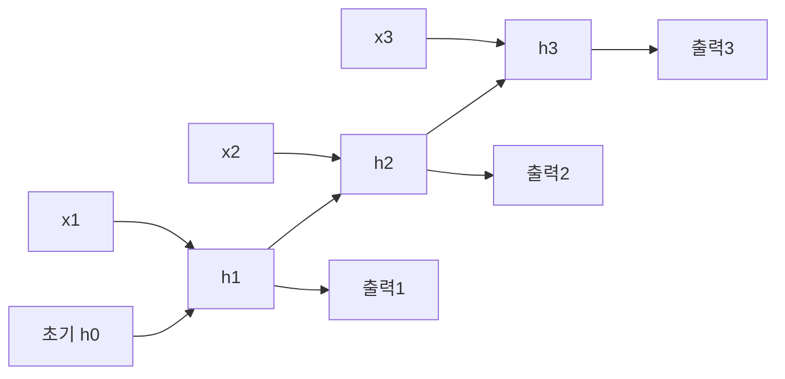

# 06. RNN과 LSTM

이전: [[05. CNN 기반 문장 분류]] · 다음: [[07. Neural Machine Translation]]

## 1. RNN

### 1.1 Sequential data

기계번역은 입력 단어 시퀀스를 출력 단어 시퀀스로 바꾸는 many-to-many 과제다.

RNN(Recurrent Neural Network)은 연속적인 입력을 처리하도록 설계된다. 가변 길이를 다루며 hidden state를 기억처럼 두고 각 timestep에 갱신한다. 이전 state가 다음 계산에 쓰이므로 같은 토큰이라도 앞의 입력에 따라 현재 state가 달라질 수 있다. 임베딩 평균이 순서를 버리는 것과 다르다.

예제는 one-to-one, one-to-many, many-to-one, many-to-many 도식을 보여준다. 문장 분류는 여러 입력에서 최종 한 출력을 만들 수 있고, 번역은 source와 target의 길이가 다른 시퀀스를 연결한다. Many-to-many라고 입력 위치와 출력 위치가 반드시 하나씩 정렬되는 것은 아니다.

### 1.2 RNN의 구조와 기호

$$
h_t=\tanh(W_{xh}x_t+W_{hh}h_{t-1}+b)
$$

| 기호 | 크기와 역할 |
|---|---|
| $x_t\in\mathbb R^d$ | 현재 토큰 입력, 보통 임베딩 |
| $h_{t-1},h_t\in\mathbb R^H$ | 이전/현재 hidden state |
| $W_{xh}\in\mathbb R^{H\times d}$ | 현재 입력을 state 공간으로 변환 |
| $W_{hh}\in\mathbb R^{H\times H}$ | 이전 state를 새 state 계산에 연결 |
| $b\in\mathbb R^H$ | State 편향 |

두 선형 변환을 더하고 tanh를 적용해 각 state 성분을 $[-1,1]$로 제한한다. $W_{xh},W_{hh}$와 출력용 $W_{hy}$는 모든 시간에서 공유한다. 그림에 cell이 여러 개 그려져 있어도 시간마다 별도 가중치를 만드는 것이 아니다.

**출력 계산.** 언어모델의 출력층을 풀어 쓰면 $z_t=W_{hy}h_t+b_y$, $p_t=softmax(z_t)$다. State H차원, 출력 어휘 V차원을 구분한다. 예제는 `[h,e,l,o]` 어휘에서 다음 글자를 sampling하고 그 결과를 다음 입력으로 쓰는 예다. Sampling은 확률에 따라 고르는 것이고 greedy argmax와 같지 않다.

모든 h 노드는 같은 recurrent 변환을 사용한다. $h_t$는 입력의 원문을 그대로 저장하는 배열이 아니라 학습된 압축 표현이다. 이전 토큰을 정확하게 복원할 수 있다고 보장하지 않는다.

**계산 예(설명용): scalar RNN 두 step**

$W_{xh}=1$, $W_{hh}=0.5$, $b=0$, $h_0=0$, $x_1=1$, $x_2=0$이라고 하자.

$$
h_1=\tanh(1)\approx0.76159
$$
$$
h_2=\tanh(0+0.5\cdot0.76159)\approx0.36340
$$

두 번째 입력이 0이어도 이전 state가 있으므로 출력이 0은 아니다. $x_3=0$이면 $h_3=\tanh(0.5h_2)\approx0.17973$로 줄어든다. 이 예는 해당 계수에서 앞의 신호가 약해지는 과정을 보여주지만 모든 RNN state가 언제나 단조 감소한다는 일반 법칙은 아니다.

### 1.3 Stacked RNN과 bidirectional RNN

Multi-layer/stacked RNN은 아래 층의 hidden state를 위 층의 입력으로 사용한다. 시간 방향 반복의 깊이에 layer 방향 깊이가 추가된다. 강의는 하위 층의 저수준 feature, 상위 층의 고수준 feature 관점과 보통 2–3층, 4층 초과에서 학습 저하 경향을 소개한다. 이 숫자는 강의의 경험적 설명이며 모든 데이터·설정에 대한 한계값이 아니다.

Bidirectional RNN은 앞→뒤와 뒤→앞을 각각 encoding하고 같은 위치의 두 state를 concat한다.

$$
h_t^{bi}=[\overrightarrow h_t;\overleftarrow h_t]
$$

**보충 차원:** 각 방향 H차원이면 concat은 2H차원이다. 앞 방향은 왼쪽 문맥, 뒤 방향은 오른쪽 문맥을 포함할 수 있다. 전체 source가 주어진 번역 encoder에 적합한 관점이다. 미래 target이 아직 없는 생성 decoder에서 양방향 정보를 그대로 쓰는 것은 같은 조건이 아니다.

양방향 문맥이 성능에 도움이 될 수 있지만, 모든 과제에서 일정한 개선 폭이 보장되지는 않는다.

### 1.4 장기 의존성의 한계

강의의 `I grew up in France … I speak fluent ___`는 멀리 앞의 France가 뒤의 French 예측에 필요한 예다. Recurrent step이 많아지면 중요한 정보가 state 갱신 속에서 희석될 수 있다. Tanh가 state 값을 제한한다고 해서 gradient까지 소실·폭발이 완전히 방지되는 것은 아니다.

**수식 전개.** $a_t=W_{xh}x_t+W_{hh}h_{t-1}+b$이면, 시간축의 국소 미분은:

$$
\frac{\partial h_t}{\partial h_{t-1}}
=\operatorname{diag}(1-h_t^2)W_{hh}
$$

먼 이전 state까지의 미분에는 이런 항들이 반복 곱으로 나타난다. 작은 크기의 항이 여러 번 곱해지면 gradient가 약해지고 큰 항이 반복되면 커질 수 있다. Scalar에서 국소 계수가 매번 0.5라면 10단계 뒤의 경로 계수는 $0.5^{10}\approx0.0009766$다. 이는 chain rule을 시간으로 적용한 설명이며 강의의 장기 의존성 문제를 수학적으로 풀어 쓴 보충이다.

표현 정보가 약해지는 현상과 학습 gradient가 약해지는 현상은 연결되지만 같은 값은 아니다. Hidden state의 현재 수치와 $\partial L/\partial h_t$를 구분한다. LSTM은 중요한 정보를 유지하는 별도 cell 경로를 도입해 이 문제를 완화한다.

## 2. LSTM

### 2.1 Cell, hidden state와 gate

LSTM(Long Short-Term Memory)은 cell state $c_t$에 정보를 저장하고 gate가 무엇을 유지·추가·출력할지 정한다. Hidden state $h_t$는 외부로 내보내는 현재 표현이다. 같은 H차원이어도 두 state의 역할이 다르다. 이전 $h_{t-1}$과 현재 $x_t$를 concat한 $q_t=[h_{t-1};x_t]$로 gate와 후보를 계산한다.

$$
f_t=\sigma(W_fq_t+b_f)
$$
$$
i_t=\sigma(W_iq_t+b_i),\qquad
\tilde c_t=\tanh(W_cq_t+b_c)
$$
$$
c_t=f_t\odot c_{t-1}+i_t\odot\tilde c_t
$$
$$
o_t=\sigma(W_oq_t+b_o),\qquad
h_t=o_t\odot\tanh(c_t)
$$

$f_t,i_t,o_t$는 H차원 gate, $\tilde c_t$는 H차원 후보 cell 값, $\odot$는 **원소별 곱**이다. $W_f,W_i,W_c,W_o$는 각각 H×(H+d), bias는 H차원이다. 서로 다른 gate가 독립된 파라미터를 갖지만 각 파라미터는 시간마다 공유한다.

| 구성 | 질문 | 범위와 작동 |
|---|---|---|
| Forget gate $f_t$ | 과거 cell에서 얼마나 남길까 | Sigmoid: 0에 가까우면 버림, 1에 가까우면 유지 |
| Input gate $i_t$ | 새 후보를 얼마나 쓸까 | Sigmoid: 후보의 성분별 반영량 |
| Candidate $\tilde c_t$ | 어떤 새 정보를 쓸까 | Tanh: 양수·음수 후보값 |
| Cell update $c_t$ | 유지된 과거와 새 정보 결합 | 덧셈 경로 |
| Output gate $o_t$ | 현재 기억을 얼마나 외부로 보일까 | Tanh(cell)을 성분별 필터링 |

Gate는 보통 완전한 0/1 스위치가 아니라 연속적인 비율이다. Sigmoid gate가 양수라고 저장 내용도 양수인 것은 아니다. 후보 $\tilde c_t$가 음수일 수 있어 cell에 음의 정보를 더할 수 있다. Cell은 합으로 갱신되므로 hidden처럼 반드시 $[-1,1]$에 제한되지는 않는다.

![[assets/lstm-architecture.svg]]

*LSTM 내부 구조. 위쪽 직선 경로는 cell, 아래쪽은 gate의 공통 입력 q. ×는 원소별 곱, +는 cell 정보 결합이다. 후보와 input gate의 역할을 분리하여 읽는다.*

### 2.2 LSTM gate와 state의 계산 예제

**Gate 계산**

단일 성분에서 forget logit이 $\ln4$, input logit이 $\ln(3/2)$, output logit이 $\ln(7/3)$이면:

$$
f=\frac4{1+4}=0.8,\qquad i=\frac{1.5}{1+1.5}=0.6,\qquad
o=\frac{7/3}{1+7/3}=0.7
$$

이 값은 affine로 계산된 gate 점수에 sigmoid를 적용한 결과다. Gate logit과 gate 출력 자체를 혼동하지 않는다. 후보 affine 점수가 $\operatorname{arctanh}(0.4)$면 후보는 tanh를 거쳐 0.4가 된다. 실제로는 모든 gate가 $q_t$에서 계산되지만 여기서는 계산을 분리해 보여준다.

**Cell과 hidden state 갱신**

$$
c_{t-1}=(0.5,-1.0),\quad f_t=(0.8,0.2),\quad
i_t=(0.6,0.9),\quad\tilde c_t=(0.4,-0.5),\quad o_t=(0.7,0.3)
$$

과거 유지분은 $(0.4,-0.2)$, 새 정보는 $(0.24,-0.45)$이다. 따라서:

$$
c_t=(0.64,-0.65)
$$
$$
h_t=(0.7\tanh0.64,\ 0.3\tanh(-0.65))
\approx(0.39543,-0.17150)
$$

첫 성분은 과거를 많이 남기고 새 양의 정보를 추가했다. 둘째 성분은 과거를 대부분 잊고 새 음의 정보를 주로 넣었다. Output gate가 0.3이라고 cell 값 -0.65가 지워지는 것이 아니다. 외부로 보이는 hidden의 해당 성분을 줄인 것이다.

**극단적인 gate의 해석**

$f=1$, $i=0$인 이상화된 경우 $c_t=c_{t-1}$로 기억을 유지한다. $f=0$, $i=1$이면 $c_t=\tilde c_t$로 새 후보만 남긴다. $o=0$이면 $h_t=0$이어도 cell 기억은 남을 수 있다. 실제 유한 logit의 sigmoid는 정확한 0·1에 도달하지 않으므로 이 값들은 극한적인 역할 설명이다.

Cell의 직접 경로만 보면 $\partial c_t/\partial c_{t-1}=f_t$다. Forget이 1 가까이에 유지되면 gradient가 더 안정적으로 흐를 수 있다. **원문 보완:** 강의의 “소실 없이 흐르는 통로”는 장점을 강조한 표현이다. Gate가 작은 경우 직접 경로도 약해지고, gate의 state 의존 경로까지 포함한 전체 미분은 더 복잡하다. LSTM이 모든 장기 의존성 문제를 완전히 없앤다고 쓰지 않는다.

## 3. RNN과 LSTM의 비교

| 비교 | Basic RNN | LSTM |
|---|---|---|
| 기억 | Hidden state 하나 | Cell과 hidden 분리 |
| 갱신 | Affine 후 tanh | 유지·추가를 gate로 결정하고 합침 |
| 출력 조절 | State가 곧 현재 표현 | Output gate로 노출량 조절 |
| 시간 공유 | Recurrent 가중치 공유 | Gate별 가중치 모두 시간 공유 |
| 장점 | 단순한 순차 모델 | 긴 정보 보존을 더 잘 학습할 경로 |
| 한계/비용 | 긴 의존성 학습이 어려움 | Gate로 계산·파라미터 증가, 완전 해결 보장 없음 |

**보충 파라미터 계산.** Input d, hidden H일 때 basic RNN의 state 갱신 파라미터는 $H(d+H+1)$이다. LSTM은 네 affine 변환이 있으므로 $4H(d+H+1)$이다. 출력층은 별도로 더한다. 이 숫자로 “LSTM이 RNN보다 구조가 복잡하다”를 설명할 수 있다.

RNN/LSTM은 문장 encoder로 state를 만들고 decoder로 target을 순차 생성할 수 있다. 다만 LSTM의 시간축 기억 개선과 Seq2Seq의 source 전체를 한 벡터에 압축하는 병목은 다른 문제다. 다음 장은 encoder-decoder, 그 다음 장은 Attention으로 연결한다.

**자기 점검과 답**

1. $f_t$가 새 정보 내용인가? **아니다. 과거 cell의 유지 비율이다.**
2. 후보에 sigmoid를 쓰는가? **이 강의의 후보는 tanh, gate는 sigmoid다.**
3. Output gate를 닫으면 cell 기억도 삭제되는가? **아니다. Hidden으로 내보내는 양을 조절한다.**
4. Stacked와 bidirectional의 차이는? **층 방향 깊이와 시간 진행 방향의 차이다.**
5. Tanh로 state가 제한되면 gradient도 항상 안정적인가? **아니다. 시간별 미분 곱을 봐야 한다.**

연결: [[07. Neural Machine Translation]] · [[08. Attention과 BLEU]]
