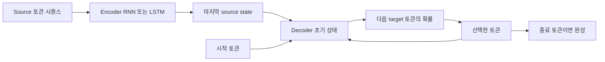

# 07. Neural Machine Translation

이전: [[06. RNN과 LSTM]] · 다음: [[08. Attention과 BLEU]]

## 1. Seq2Seq

### 1.1 Encoder–Decoder

NMT(Neural Machine Translation)는 하나의 end-to-end 신경망으로 source 문장을 target 문장으로 번역하는 sequence-to-sequence 모델이다.

Encoder RNN은 source 토큰을 읽으며 state를 갱신한다. 마지막 hidden state를 decoder의 초기 상태로 전달한다. Decoder RNN은 source encoding에 조건화된 언어모델로 target 토큰을 하나씩 생성한다. Source와 target은 길이와 어순이 달라도 된다.

Source 전체를 먼저 encoding하고 target 생성을 시작한다. Decoder의 한 step은 이전 target 정보와 현재 decoder state를 사용해 다음 어휘 분포를 만든다. 그림의 target 출력과 다음 step 입력이 한 칸 이동하는 이유는 **이전 토큰으로 다음 토큰을 예측**하기 때문이다. 시작 토큰은 첫 target 예측을 시작하고 종료 토큰은 문장 생성을 끝내는 역할이다.

**보충 표기.** Source를 $x=(x_1,\ldots,x_N)$, target을 $y=(y_1,\ldots,y_T)$라고 쓰면 encoder $h_N$이 decoder $s_0$의 초기 정보가 된다. RNN decoder에서는 $s_t=f(s_{t-1},emb(y_{t-1}))$ 형태로 이해할 수 있다. LSTM일 때는 hidden과 cell이 함께 상태를 이룬다는 점을 별도로 고려한다. 강의의 기본 설명은 마지막 hidden state 전달이다.

### 1.2 Seq2Seq 확률과 손실

$$
P(y\mid x)=\prod_{t=1}^{T}P(y_t\mid y_1,\ldots,y_{t-1},x)
$$
$$
J_t=-\log P(y_t\mid y_1,\ldots,y_{t-1},x),\qquad
J=\frac1T\sum_{t=1}^{T}J_t
$$

$N$은 source 길이, $T$는 평가할 target 예측 step 수, $y_t$는 그 step의 정답 토큰이다. 각 step의 어휘 Softmax에서 **정답 단어 확률**을 가져와 negative log를 계산한다. 평균 손실은 문장 길이로 나눈다. 확률 곱은 로그를 취하면 합으로 바뀌므로 작은 확률을 직접 계속 곱하지 않아도 된다.

**계산 예(설명용): 세 target step**

정답 토큰들의 확률이 `[0.8,0.5,0.25]`라면:

| Step | 정답 확률 | $J_t=-\ln p_t$ |
|---|---:|---:|
| 1 | 0.8 | 0.22314 |
| 2 | 0.5 | 0.69315 |
| 3 | 0.25 | 1.38629 |

조건부 sequence 확률은 $0.8\cdot0.5\cdot0.25=0.1$이다. 합 NLL은 $-\ln0.1\approx2.30259$, 평균은 $2.30259/3\approx0.76753$이다. 세 번째 정답 확률이 가장 작아서 loss 기여가 가장 크다.

**보충 주의.** EOS까지 정답으로 학습하는 설정이면 EOS 예측도 T에 포함한다. Padding 위치를 실제 정답 토큰으로 세지 않도록 해야 한다. 이 노트의 숫자 예는 T=3이라고 명시했으며, 서로 다른 예제에서 합 손실과 평균 손실을 섞지 않는다.

### 1.3 학습과 생성의 입력 차이

강의 손실은 정답 prefix $y_1,\ldots,y_{t-1}$에 조건화한 확률이다. 학습 때 이전 정답 토큰을 입력으로 사용하는 설명을 teacher forcing이라고 부른다. 생성 때는 아직 정답을 모르므로 이미 생성한 토큰을 다음 입력으로 사용한다. 이 용어는 원문에서 상세하게 전개하지 않으며, 정답 prefix를 쓰는 손실식을 이해하기 위한 명명이다.

틀린 이전 토큰을 생성하면 이후 조건이 달라져 뒤의 확률도 달라질 수 있다. “각 step에서 가장 좋은 확률을 고르면 전체 문장이 가장 좋다”는 결론이 성립하지 않는 이유와 연결된다. 학습에서는 decoder의 오차가 encoder까지 역전파되어 전체 시스템이 함께 최적화된다. Encoder를 별도 고정 feature extractor로만 학습하는 구조와 다르다.

## 2. Decoding

### 2.1 Greedy decoding

Greedy는 매 step 가장 높은 확률의 토큰을 하나 선택한다.

$$
\hat y_t=\arg\max_wP(w\mid\hat y_{<t},x)
$$

각 시점에는 선택이 최선이어도 다른 초기 선택으로 시작한 문장 전체의 확률이 더 높을 수 있다. 이미 버린 대안을 뒤에서 다시 복구하지 못한다. 강의 예의 `he → he hit → he hit a`에서 이후 잘못된 선택을 알아도 되돌릴 방법이 없다는 것이 핵심이다.

**계산 예(설명용).** 첫 단어 후보 A=0.6, B=0.4이고 A 다음 가장 좋은 후보 C=0.5, B 다음 D=0.9라고 하자. 두 토큰 길이에서 greedy는 A를 골라 AC 확률 $0.6\cdot0.5=0.30$으로 끝난다. BD는 $0.4\cdot0.9=0.36$이어서 더 높다. 첫 step 최고 확률과 완성 sequence 최고 확률은 다르다.

Greedy는 한 경로만 유지하므로 간단하고 빠르다. Sampling은 확률적으로 후보를 고르고 beam은 여러 경로를 유지하므로 이 세 방식의 차이를 구분한다. Decoder 구조를 바꾸는 것이 아니라 **출력 분포에서 무엇을 선택할지**를 바꾸는 전략이다.

### 2.2 Beam search의 점수와 가지치기

Beam은 상위 k개의 부분 번역(hypothesis)을 유지한다. k는 beam size이며 강의에서는 실제 NMT에서 보통 5–10을 언급한다. 이것은 번역마다 반드시 그 수를 써야 한다는 규칙은 아니다.

$$
score(y_{1:t})=\log P(y_{1:t}\mid x)
=\sum_{i=1}^{t}\log P(y_i\mid y_{<i},x)
$$

확률이 0과 1 사이면 로그는 음수이고 **덜 음수일수록 점수가 높다**. 확률 1의 로그는 0이므로 엄밀히는 비양수다. 각 step에서 남아 있는 k개 prefix를 확장하고 그 모든 자식 후보를 모아 누적 score의 상위 k개를 선택한다. 각 parent에서 하나씩 뽑는 규칙이 아니다. 하나의 parent에서 나온 자식들이 beam을 모두 차지할 수 있다.

**계산 예(설명용): beam size 2**

어휘를 A,B,C,D로 두고 모든 경로를 두 토큰 후 종료하는 작은 예를 사용한다. 첫 step 분포는 A=0.6, B=0.4, 나머지 0이다. A 뒤 분포는 C=0.5, D=0.3, A=0.1, B=0.1이다. B 뒤 분포는 D=0.9, C=0.05, A=0.025, B=0.025다.

| Step 1 유지 | 확률 | 누적 log score |
|---|---:|---:|
| A | 0.6 | -0.51083 |
| B | 0.4 | -0.91629 |

Step 2에서 각 prefix를 확장한다.

| 확장 | Sequence 확률 | 누적 log score | 결과 |
|---|---:|---:|---|
| BD | 0.36 | -1.02165 | 1위 유지 |
| AC | 0.30 | -1.20397 | 2위 유지 |
| AD | 0.18 | -1.71480 | 가지치기 |
| AA, AB | 각 0.06 | 각 -2.81341 | 가지치기 |
| BC | 0.02 | -3.91202 | 가지치기 |
| BA, BB | 각 0.01 | 각 -4.60517 | 가지치기 |

Greedy는 AC를 선택하지만 beam=2는 BD도 유지하여 더 높은 완성 점수의 경로를 찾는다. 이 예는 EOS 확률을 모두 1로 이상화했으므로 이후 종료 log는 0이며 순위가 바뀌지 않는다. 실제 종료 문제는 다음 절처럼 따로 처리한다.

![[assets/beam-search.svg]]

*새로 만든 위 계산 예의 탐색 트리. 파란 가지는 step 2 상위 2개, 회색은 가지치기. 노드 숫자는 조건부 확률이 아니라 누적 log score다.*

**Beam search의 순서**

1. 시작 상태를 하나의 빈 prefix로 둔다.
2. 살아 있는 각 prefix에서 다음 토큰 확률을 계산한다.
3. 이전 누적 score에 해당 토큰의 log 확률을 더한다.
4. 확장 후보 전체에서 상위 k개를 유지한다.
5. 종료한 후보를 관리하고, 최종 최고점 경로를 backtrack해 복원한다.

예제의 원본 k=2 트리도 누적 score를 비교해 가지치기하는 구조다. 이 노트의 작은 예제는 원본 트리 숫자를 임의로 바꿔 ‘원문 예제’라고 쓰지 않고 보충 계산으로 분리했다.

### 2.3 종료, 한계와 탐색 목적

종료 토큰을 생성한 hypothesis는 완성된 문장이다. 이후 다른 토큰으로 계속 확장하지 않는다. 구현에서는 미완성 beam과 완성 후보를 구분하고 최대 길이 등의 조건을 정한다. 이 강의는 기본 가지치기를 설명하며 모든 종료 규칙·length normalization 변형을 자세히 다루지 않는다.

원래 log 확률 합은 토큰을 추가할 때 비양수 항을 더하므로 길어질수록 낮아지기 쉽다. 서로 다른 길이 후보를 비교할 때 이런 성질을 인지해야 한다. **범위:** length normalization의 특정 식이나 추가 penalty를 강의 공식으로 넣지 않는다. 강의의 score 정의는 순수 누적 log 확률이다.

Beam은 exhaustive search보다 훨씬 적은 후보를 유지하지만 최적해를 보장하지 않는다. 초기에 낮은 prefix가 나중에 매우 좋은 후속 토큰으로 이어져도 이미 가지치기되었으면 되살아나지 않는다. k=1은 기본 동일 길이 확장 관점에서 greedy와 같고, k를 키우면 더 많은 대안을 보지만 계산·메모리 비용이 늘어난다.

**보충 비용 해석.** 어휘 V개를 k개 prefix마다 검사하면 step당 약 kV개의 확장 점수를 비교한다. 모든 길이 T 시퀀스를 완전 탐색하면 후보 수는 V의 T제곱 수준으로 증가한다. Beam은 후보 수를 제한해 현실적인 탐색을 한다.

높은 model score가 사람이 보기에 완벽한 번역이라는 보장은 아니다. Beam은 주어진 모델의 확률 목표를 탐색하고, BLEU는 reference와 n-gram 일치를 평가한다. Training loss, decoding score, 번역 품질 평가를 서로 같은 값으로 취급하지 않는다.

## 3. 정보 병목과 Attention

Basic 모델은 마지막 source state 하나만 사용한다. Source가 길면 모든 의미를 고정 차원 하나에 압축하기 어려워 정보가 손실될 수 있다. LSTM은 encoder 내부의 기억 유지에 도움이 되지만, decoder가 source 전체 state를 직접 참조하지 못하는 구조적 병목은 남는다.

Attention은 decoding step마다 모든 encoder state를 다시 참조해 필요한 부분을 선택적으로 가져온다. Beam은 후보 탐색을 넓히고 Attention은 decoder가 사용하는 source 정보를 바꾼다. 둘은 같은 문제의 동일한 해결책이 아니며 함께 사용될 수 있다.

**자기 점검과 답**

1. Seq2Seq의 T는 source 길이인가? **원문 평균 손실에서는 target 예측 길이다.**
2. Beam score -1.2와 -0.8 중 좋은 것은? **-0.8이다.**
3. Beam k=2이면 각 parent의 가장 좋은 자식 하나씩을 선택하는가? **아니다. 확장 전체에서 상위 2개다.**
4. Beam이 model 확률의 전역 최적해를 보장하는가? **아니다. 가지치기된 prefix를 복원하지 못한다.**
5. LSTM, Attention, Beam의 역할은? **시간축 기억, source 접근, 출력 경로 탐색이다.**

연결: [[08. Attention과 BLEU]]
