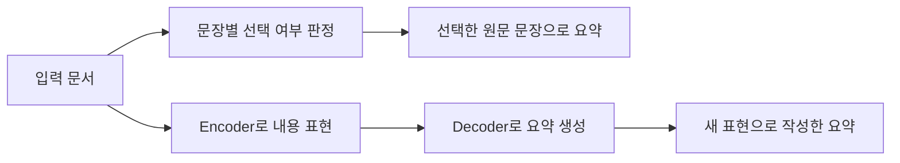

# 09. Text Summarization

이전: [[08. Attention과 BLEU]]

## 1. 텍스트 요약

텍스트 요약은 입력 $x$보다 짧으면서 **핵심 정보를 담은 텍스트 $y$**를 만드는 과제다. 단순히 문장을 짧게 자르는 것이 아니라 무엇을 남길지 선택해야 한다.

| 종류 | 입력 | 핵심 |
|---|---|---|
| Single-document | 문서 하나 | 한 문서의 주요 정보 압축 |
| Multi-document | 관련 문서 여러 개 | 겹치는 내용을 정리하여 요약 |

문서 요약은 기사·문서의 핵심 정보를, 이메일 요약은 긴 본문의 요지를, 회의 요약은 논의 주제와 결정사항을 추린다. 여러 문서가 같은 사건을 다루면 단순히 각 문서의 요약을 이어 붙이는 것보다 중복 정보를 줄여야 한다.

### 1.1 Extractive와 abstractive summarization

| 비교 | Extractive: 추출식 | Abstractive: 생성식 |
|---|---|---|
| 동작 | 원문의 일부, 보통 문장을 선택 | 새로운 요약 텍스트 생성 |
| 문제 형태 | 문장별 포함 여부를 판정하는 분류에 가까움 | Encoder–Decoder 기반 생성 |
| 표현 | 선택한 원문 표현 유지 | 원문 내용을 다른 말로 재작성 가능 |
| 장점 | 상대적으로 쉬움 | 유연하고 사람이 쓴 요약에 가까움 |
| 한계 | Paraphrasing 불가 | 더 복잡한 모델·많은 데이터 필요 |

추출식은 **무슨 문장을 고를지**, 생성식은 **무슨 내용을 어떻게 말할지**를 결정한다. 생성식 요약에서는 encoder가 입력을 표현하고 decoder가 그 정보에 조건화하여 요약 토큰을 생성한다. 번역에서 다룬 [[07. Neural Machine Translation#1.1 Encoder–Decoder|Encoder–Decoder]]와 같은 틀을 사용하되, 출력 목표가 번역문 대신 짧은 요약이다.

**예(설명용).** 원문이 “회의는 금요일에 열린다. 회의실은 301호다.”라면 추출식은 두 문장 중 하나 또는 둘을 선택한다. 생성식은 “금요일 301호에서 회의한다.”처럼 내용을 합쳐 다시 표현할 수 있다.

### 1.2 데이터셋과 관련 과제

| 데이터셋 | Source → 요약 |
|---|---|
| Gigaword | 뉴스 첫 1–2문장 → headline |
| LCSTS | 중국어 microblog 문단 → 한 문장 |
| NYT, CNN/DailyMail | 뉴스 기사 → 여러 문장 |
| Wikihow | How-to 문서 전체 → 요약 문장들 |
| XSum, Newsroom | 기사 → 한 문장 |

Source와 요약의 길이·스타일이 다르므로 모든 데이터셋을 같은 형태의 ‘문장 압축’으로 보면 안 된다. Headline 생성과 문서 전체의 여러 문장 요약은 보존해야 할 정보량도 다르다.

Sentence simplification은 관련되지만 목적이 다르다. **요약은 핵심 정보의 압축**, **단순화는 읽기 쉬운 표현으로 재작성**이다. 단순화 결과가 짧아질 수는 있지만 길이 감소 자체가 핵심 목표는 아니다. Simple Wikipedia는 일반 문장의 단순화 버전, Newsela는 기사를 어린이용으로 재작성한 사례다.

## 2. 텍스트 생성 평가

| 방식 | 평가 기준 | 예 |
|---|---|---|
| Content overlap | Reference와 생성문에 겹치는 내용 | BLEU, ROUGE |
| Model-based | 학습된 모델로 생성문 품질 판정 | 평가 모델의 출력 |
| Human evaluation | 사람이 직접 품질 판정 | 사람이 읽고 판단 |

Content overlap은 빠르고 효율적이지만 **겹치는 표현이 있다는 것과 의미가 정확하다는 것은 다르다.** `They walked to the grocery store.`와 `The woman went to the hardware store.`는 일부 표현이 겹쳐도 등장인물과 목적지가 다르다.

Overlap 지표도 구분된다. N-gram overlap에는 BLEU·ROUGE·METEOR·CIDEr, semantic overlap에는 PYRAMID·SPICE·SPIDEr가 소개된다. 이 자료에서 계산까지 다루는 것은 ROUGE와 앞서 배운 BLEU이며, 나머지 지표의 상세 식은 제시되지 않는다.

## 3. ROUGE

### 3.1 ROUGE-N의 원리

ROUGE(Recall-Oriented Understudy for Gisting Evaluation)는 reference 요약과 candidate 요약의 겹침을 측정한다. 기본 ROUGE-N은 **reference의 n-gram을 얼마나 회수했는지** 보는 recall이다.

$$
\operatorname{ROUGE}\text{-}N
=\frac{\sum_{S\in\mathcal R}\sum_{g\in S}\operatorname{Count}_{match}(g)}
{\sum_{S\in\mathcal R}\sum_{g\in S}\operatorname{Count}(g)}
$$

$\mathcal R$은 reference 요약들의 집합, $g$는 연속된 N개 토큰의 n-gram, $\operatorname{Count}_{match}$는 candidate와 맞는 출현 수다. **분모는 reference의 n-gram 수**다. 아래 계산은 reference 하나를 사용한다.

길이 $L$인 문장의 unigram 수는 $L$, bigram 수는 $L-1$이다. 겹침은 단어가 존재하는지만 보지 않고 출현 수로 센다. 같은 표현을 반복해서 reference에 있는 횟수보다 더 많이 맞았다고 인정하지 않는다.

| 지표 | 비교 단위 | 특징 |
|---|---|---|
| ROUGE-1 | Unigram | 단어 수준 겹침, 어순을 구분하기 어려움 |
| ROUGE-2 | Bigram | 인접 단어 순서를 반영 |
| ROUGE-L | Longest Common Subsequence | 떨어진 단어도 순서가 유지되면 반영 |

ROUGE-1·2·L은 보통 **각각 보고**한다. BLEU처럼 1–4-gram 점수를 기하평균으로 합쳐 하나의 ROUGE를 만드는 방식이 아니다.

### 3.2 ROUGE-1·2 계산

Reference와 두 candidate를 비교한다.

| 구분 | 문장 |
|---|---|
| Reference $S_1$ | `police killed the gunman` |
| Candidate $S_2$ | `police kill the gunman` |
| Candidate $S_3$ | `the gunman kill police` |

**ROUGE-1.** Reference의 4개 unigram 중 두 candidate 모두 `police`, `the`, `gunman` 3개가 겹친다. `kill`과 `killed`는 이 예제의 토큰 비교에서 다르게 센다.

$$
R_1(S_2)=R_1(S_3)=\frac34=0.75
$$

**ROUGE-2.** Reference bigram은 `(police,killed)`, `(killed,the)`, `(the,gunman)`의 3개다. 두 candidate 모두 `(the,gunman)` 하나만 겹친다.

$$
R_2(S_2)=R_2(S_3)=\frac13\approx0.3333
$$

$S_2$는 경찰이 gunman을 죽이는 내용이고, $S_3$는 그 관계를 뒤집는다. ROUGE-1·2는 두 문장의 차이를 구분하지 못한다. **점수에 포함되지 않는 의미 차이**를 평가의 한계로 설명할 수 있어야 한다.

### 3.3 ROUGE-L과 LCS

LCS(Longest Common Subsequence)는 **순서를 유지하는 가장 긴 공통 부분수열**이다. Subsequence는 연속할 필요가 없지만 순서를 바꿀 수 없다. Substring처럼 반드시 붙어 있어야 하는 것도, 단어 집합처럼 순서를 무시하는 것도 아니다.

Reference 길이를 $m$, candidate 길이를 $n$, LCS 길이를 $l$이라고 하면:

$$
R_L=\frac lm,\qquad P_L=\frac ln,\qquad
F_{1,L}=\frac{2P_LR_L}{P_L+R_L}
$$

이 식은 LCS와 precision/recall의 정의를 풀어 쓴 것이다. 두 문장 길이가 다르면 $R_L$과 $P_L$도 다를 수 있으므로 ‘LCS 길이를 4로 나누기’를 모든 예제에 적용하지 않는다.

![[assets/rouge-l-alignment.svg]]

*파란 토큰은 선택한 LCS다. 선은 두 문장에서 대응하는 토큰을 연결하며, LCS의 순서를 유지한다.*

| Candidate | LCS | 길이 | $R_L$ | $P_L$ | $F_{1,L}$ |
|---|---|---:|---:|---:|---:|
| $S_2$: police kill the gunman | police → the → gunman | 3 | 3/4 | 3/4 | 0.75 |
| $S_3$: the gunman kill police | the → gunman | 2 | 2/4 | 2/4 | 0.50 |

모든 문장 길이가 4라 recall=precision=F1이다. $S_3$의 police를 끝에서 선택하면 그 앞의 `the gunman`과 reference에서의 순서가 맞지 않는다. 따라서 세 단어를 모두 LCS로 묶을 수 없다. ROUGE-L은 ROUGE-1·2가 구분하지 못한 두 candidate를 구분한다.

**LCS의 한계**

$S_4$가 `the gunman police killed`이면 `(the gunman)`과 `(police killed)` 각각 길이 2의 공통 부분수열이다. 하지만 둘을 이어 붙이면 reference 순서와 어긋나므로 하나의 길이 4 LCS가 되지 않는다.

$$
R_L(S_4)=2/4=0.5,\qquad R_2(S_4)=2/3\approx0.6667
$$

ROUGE-L에서는 $S_3$와 같지만 ROUGE-2에서는 더 높다. 서로 다른 지표는 다른 순서 정보를 반영하므로 한 지표만으로 품질을 완전히 판단하기 어렵다.

### 3.4 Precision·Recall·F1

ROUGE에는 BLEU의 brevity penalty가 없다. Recall만 보면 정답 내용을 포함하면서 불필요한 단어를 덧붙인 candidate도 높은 점수를 받을 수 있다. 그래서 실제 보고에서는 precision과 recall을 결합한 F1을 자주 사용한다.

$$
R=\frac{\text{겹치는 n-gram 수}}{\text{reference n-gram 수}},\quad
P=\frac{\text{겹치는 n-gram 수}}{\text{candidate n-gram 수}},\quad
F_1=\frac{2PR}{P+R}
$$

Reference는 `the cat was under the bed`다.

- A: `the cat was found under the bed` — 7 tokens.
- B: `the tiny little cat was found under the big funny bed` — 11 tokens.

Reference는 unigram 6개, bigram 5개다. A·B 모두 reference unigram 6개를 포함하므로 unigram recall은 1이다. 하지만 candidate의 분모가 커지면 precision이 낮아진다.

| Candidate | R1 | P1 | F1-1 | R2 | P2 | F1-2 |
|---|---:|---:|---:|---:|---:|---:|
| A | 6/6 = 1 | 6/7 = 0.8571 | 12/13 = 0.9231 | 4/5 = 0.8 | 4/6 = 0.6667 | 8/11 = 0.7273 |
| B | 6/6 = 1 | 6/11 = 0.5455 | 12/17 = 0.7059 | 2/5 = 0.4 | 2/10 = 0.2 | 4/15 = 0.2667 |

A의 일치 bigram은 `the cat`, `cat was`, `under the`, `the bed`다. B는 삽입된 단어 때문에 인접 관계가 끊겨 `cat was`, `under the`만 일치한다. 표의 F1은 합쳐진 ‘전체 ROUGE-F1’이 아니라 **각 n-gram 차수의 F1**이다.

예를 들어 A의 ROUGE-2 F1은:

$$
F_1=\frac{2(4/6)(4/5)}{4/6+4/5}=\frac8{11}\approx0.7273
$$

Unigram recall만으로는 A와 B가 같지만 F1은 더 장황한 B를 낮게 평가한다. 길이 제한이 있는 요약에서 coverage를 보려는 목적과, 길이 제한 없이 길게 출력해 recall을 높이는 행동을 구분한다.

### 3.5 BLEU와의 비교

| 비교 | BLEU | ROUGE |
|---|---|---|
| 기본 관점 | 생성한 내용이 참조와 얼마나 맞나: precision | 참조의 내용을 얼마나 포함했나: recall |
| 기본 분모 | Candidate n-gram 수 | Reference n-gram 수 |
| 길이 처리 | 짧은 candidate에 BP | 별도 BP 없음 |
| 보고 형태 | 보통 1–4-gram 기하평균의 한 점수 | ROUGE-1·2·L 등 각각 보고 |
| P/R 결합 | 기본 BLEU의 핵심은 modified precision | F1 버전을 자주 보고 |
| 공통 한계 | 참조와 표현이 달라 의미를 놓칠 수 있음 | 토큰 겹침·LCS만으로 의미를 완전히 판단하기 어려움 |

BLEU의 [[08. Attention과 BLEU#2.2 Brevity penalty와 전체 식|BP와 기하평균]]을 ROUGE에 그대로 적용하지 않는다. 평가 결과를 읽을 때는 ‘ROUGE-1인가 ROUGE-L인가’, ‘recall인가 F1인가’를 함께 확인한다.
